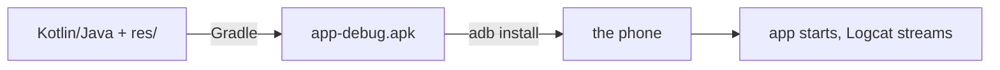

# Android Studio

**Android Studio** is Google's IDE for Android apps, and the normal place to build, run, debug and profile one. This page sets up a Studio project, in its own repository, to use this device. Nothing about the device is special to Studio: it shows up as an ordinary debuggable phone. What the device adds (debugging any process, root, profiling other apps) is described as each tool comes up.

## Install it on the same SDK

`./aosp-academy setup --studio` installs Android Studio on Windows (with winget) along with the rest of the workstation. On Linux and macOS, install it from [developer.android.com](https://developer.android.com/studio); `setup` lists the other packages it can't install itself.

What matters is that Studio uses **the same Android SDK** as this project:

- `setup` installs the pinned SDK packages into one SDK directory and records it in `ANDROID_HOME`. On Windows that's `%LOCALAPPDATA%\Android\Sdk`, set as a per-user environment variable, so Studio, Gradle and every terminal opened afterwards see it. On Linux and macOS it's `~/Android/Sdk` (or an `ANDROID_HOME` you already had); `setup` doesn't change your shell profile there, so export `ANDROID_HOME` yourself if your projects build outside Studio.
- On Windows and Linux, Studio's own default SDK location is that same directory, so on first run it finds the SDK already there and doesn't download the platform again. On macOS Studio defaults to `~/Library/Android/sdk`, which is not where `setup` puts it. Wherever its setup wizard or **Settings, Languages & Frameworks, Android SDK** asks, point it at `ANDROID_HOME`.
- Studio may add packages of its own to that SDK (another build-tools version, emulator images). That's fine: this project's commands look for their pinned versions by name, not for the newest present.

`./aosp-academy check` confirms the SDK packages, and warns (it doesn't fail) when Studio isn't installed.

## One adb version

There are two copies of `adb`, Android's debug bridge between the PC and the phone: Studio uses the one in the SDK's `platform-tools`, and this project's commands use the pinned copy in `work/platform-tools`. Both are **37.0.3**. That matters because only one adb *server* runs per PC, and two different versions take turns killing each other's server, which shows up as devices dropping out of Studio and commands failing at random.

`./aosp-academy check` compares the two and fails if they differ. If Studio's SDK Manager offers a newer platform-tools, decline it until the pin in `toolchain.json` moves too (the [pins](../reference/pins.md) page explains how a pin moves). With the versions equal you can use Studio and `aosp-academy` commands at the same time.

## Create a project

The quickest start is `aosp-academy new-app`. It writes a small Kotlin project already set for this device: compileSdk and targetSdk 37, the pinned build-tools, the Android Gradle Plugin and Gradle versions in `toolchain.json` (`appTemplate`), a Gradle wrapper that checks the distribution's SHA-256, and one instrumented test.

```sh
./aosp-academy new-app ../my-app --package com.example.myapp          # write the project
./aosp-academy new-app ../my-app --package com.example.myapp --test   # ... then build it and run its test on the phone
```

`--test` builds the debug APK and runs `./gradlew connectedDebugAndroidTest`, which installs the app and its test APK on the phone, runs the test and uninstalls both: a check of the whole chain from the SDK to the device. The project doesn't depend on this repository afterwards; it needs only `ANDROID_HOME` and a JDK, which `setup` sets. Open the folder in Studio, or `git init` it as its own repository. Its `MainActivity` is a plain `android.app.Activity` with no libraries, so add Compose or AndroidX as the app needs them.

To start from Studio's own templates instead:

1. **New Project**, then **Empty Activity** (Jetpack Compose) or **Empty Views Activity** (XML layouts).
2. Pick a package name (for example `com.example.firstapp`), the language (Kotlin is Studio's default) and a minimum SDK. Finish.
3. Gradle, Android's build system, syncs the project. The first sync downloads Gradle and the libraries and takes a few minutes.

Settings that fit this device, in the module's `build.gradle.kts`:

| Setting | Value | Why |
| --- | --- | --- |
| `compileSdk` | 37 | The image is Android 17, API 37, and the SDK's pinned platform is `android-37.0`: compile against the APIs the device has |
| `targetSdk` | 37 | So the app runs with Android 17's behaviour, which is what this device shows you |
| `minSdk` | whatever your app needs | The device doesn't constrain it |
| ABI filters, if any | `arm64-v8a` | The phone's only ABI; see [native code](native-code.md) |

## Run it on the device

1. Connect the phone by USB. If Studio's PC isn't one whose key is built into the image, tap **Allow** on the phone's *Allow USB debugging?* prompt (tick *Always allow*). See [adb authorisation](the-image.md#usb-debugging-and-adb-authorisation).
2. Pick the phone in the device menu of the toolbar (`adb devices` in a terminal lists the same device).
3. Click **Run**. Studio builds the APK with Gradle, installs it with adb and starts it.



Installs are quick: the image doesn't send adb installs to a package verifier, and animations are off, so the app is on screen as soon as it starts. The same works without a cable: `adb tcpip 5555` over USB, then `./aosp-academy adb-wifi`, and Studio lists the Wi-Fi device too.

## The tool windows that use the device

| In Studio | On this device |
| --- | --- |
| **Logcat** | The system log, filtered to your app or not. The buffers are 16 MiB, so the start of a session is still there minutes later ([debugging](debugging.md#logs)) |
| **Run, Attach Debugger to Android Process** | Lists every process with **Show all processes** ticked, `system_server` and SystemUI included, so you can set breakpoints in framework and app code you didn't write. The image opens JDWP in every process ([debugging](debugging.md#attach-to-any-process)) |
| **Profiler** | Heap dumps and allocation tracking, also for apps that aren't yours, because the image is a `userdebug` build. The **system trace** recording is Perfetto, the same data as `aosp-academy device trace` ([tracing](tracing.md)). The **Callstack Sample** CPU recording uses simpleperf, which this kernel doesn't support ([the gap](tracing.md#the-simpleperf-gap)) |
| **Layout Inspector** | Your app's live view or Compose hierarchy |
| **Device Explorer** | The phone's file system. After `adb root` it shows everything, not only what the shell user may read |
| **Terminal** | A shell. Put the project's pinned tools on its PATH as below |

### The project's tools in Studio's terminal

Studio's terminal doesn't have `frida-ps`, `jadx` or the pinned `adb` on PATH by itself. Load this project's environment into it, from this repository's root:

=== "PowerShell"

    ```powershell
    .\aosp-academy env | Invoke-Expression
    ```

=== "bash"

    ```bash
    eval "$(./aosp-academy env --shell bash)"
    ```

`aosp-academy env` prints the statements that set `ANDROID_HOME`, `JAVA_HOME`, `ANDROID_NDK_HOME` and `ADB` and put the pinned platform-tools first on PATH, followed by the JDK, the SDK command-line tools, build-tools, the NDK, `jadx` and the Frida venv. `--shell cmd` prints the `cmd.exe` form.

## Where to go next

- [Debugging](debugging.md): breakpoints in any process, `adb jdwp`, logs and bug reports.
- [Native code](native-code.md): a C or C++ library in the app with the NDK.
- [Tracing](tracing.md) and [instrumentation](instrumentation.md): what the whole device does, and what one function does.
- Google's [Android developer guides](https://developer.android.com/guide) cover the app framework itself: activities, services, Jetpack, Compose.
