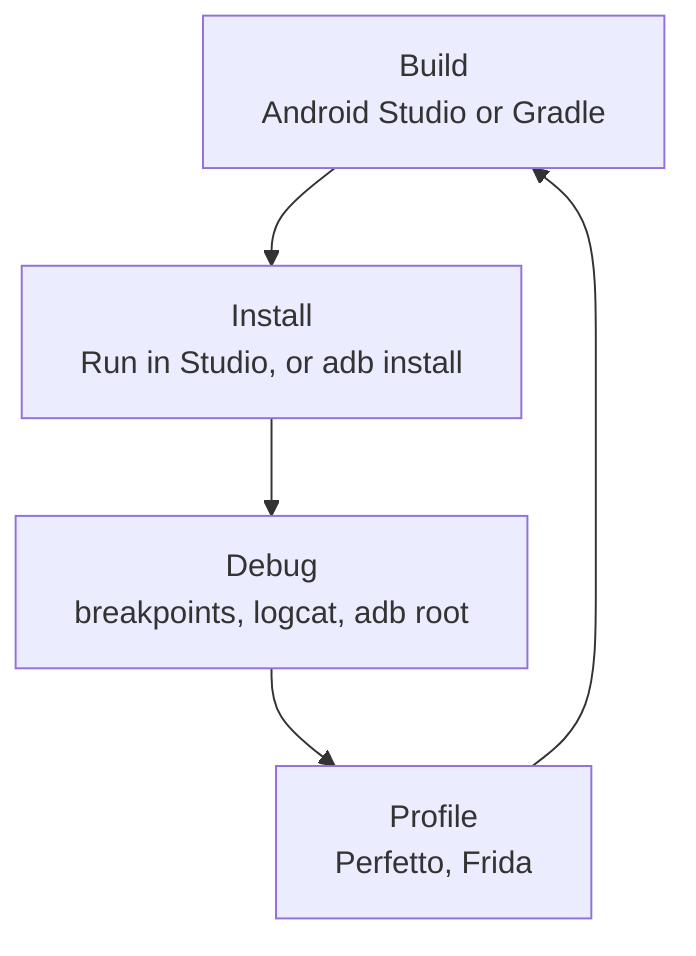

# Develop apps against the device

This section is for people who build apps **in other projects** and use this project's phone as their test device. aosp-academy doesn't hold app code. It holds what makes the phone and the PC an environment to develop on: the pinned SDK, NDK and analysis tools on the workstation, and a system image on the phone that is built for debugging. Your app project points at that environment and uses it.

!!! note "Shell commands on these pages"
    The commands assume a shell opened with `./aosp-academy shell` from this repository's root (`.\aosp-academy shell` on Windows). In it, the pinned `adb`, the SDK build tools, the NDK, the JDK, `jadx` and the Frida tools are on PATH, so `adb shell ...` means the tested adb. `aosp-academy` commands are run from the repository root, as `./aosp-academy <command>` (`.\aosp-academy <command>` on Windows). The [CLI reference](../reference/cli.md) lists every command.

## What an app project gets

From the **workstation** (set up once with `aosp-academy setup`, see [the workstation](../start/workstation.md)):

- the Android SDK at `ANDROID_HOME`, with the platform for Android 17 (`android-37.0`, API 37), build-tools 37.0.0 and NDK 30.0.16248370. Android Studio and Gradle builds in any project find it there;
- one `adb` version, 37.0.3, both in the SDK Studio uses and in the project's own pinned copy, so the two never fight over the phone;
- a JDK 21, and the tools for looking inside apps and processes: `jadx`, `apktool`, `apksigner`, `aapt2`, Frida and Perfetto's trace recorder.

From the **device**, running the aosp-academy image (Android 17, a `userdebug` build made from AOSP source, see [what the image gives you](the-image.md)):

- a debugger that attaches to **any** process, `system_server` and SystemUI included, not only to your own debuggable build;
- root whenever you need it (`adb root`, or `su 0` on the phone);
- 16 MiB log buffers, so logs from a few minutes ago are still there;
- animations off and no install verification, so installs are fast and UI tests start from a settled screen;
- no Google apps or services, so what you see is your app on plain AOSP.

## The everyday loop



1. **Build** in [Android Studio](android-studio.md), or from the command line with your project's Gradle wrapper (`./gradlew assembleDebug`). Both use the SDK at `ANDROID_HOME`.
2. **Install** with Studio's **Run**, or `adb install -r app-debug.apk`. The phone doesn't send adb installs to a verifier first, so an install takes seconds.
3. **Debug**: breakpoints in Studio, the system log, root shells. [Debugging](debugging.md) covers attaching to any process, `adb jdwp`, logcat and bug reports.
4. **Profile**: a system-wide timeline with [Perfetto](tracing.md), function-level hooks with [Frida](instrumentation.md). Native code has its own page: [the NDK](native-code.md). To look inside an APK, yours or someone else's, see [inspecting apps](inspecting-apps.md).

To check that the whole loop works on the phone right now, run the device test:

```sh
./aosp-academy device test
```

It builds a small app with the SDK tools alone, installs it, launches it, reads its log line and uninstalls it, then checks root, logs, an NDK binary, the debugger list, a Perfetto trace, Frida and screen mirroring. It leaves nothing behind, and its exit code is the number of failed checks. `aosp-academy deploy` runs it after every new image.

## Things to know before you start

- **Every deploy of a new image wipes the image's data**, your installed apps included. The device is a test target, not a store: keep everything in your project, and expect to reinstall after a deploy. [What the image gives you](the-image.md#what-a-deploy-wipes) has the details.
- **Seeing the screen.** `./aosp-academy device mirror` mirrors and controls the phone in a window on the PC (scrcpy, with any extra options passed through).
- **No cable.** The image's adbd listens on TCP port 5555 from the first boot, so `./aosp-academy adb-wifi` (with the cable in once, to read the phone's address) connects adb over Wi-Fi. The PC and the phone must be on the same network; the command says so if they aren't. Studio lists the Wi-Fi device like any other.
- **The device is shared with this project.** Changing the image itself (adding a package, a default, a patch) is the other half of this site: [change the environment](../environment/index.md).

## Pages in this section

| Page | What it covers |
| --- | --- |
| [What the image gives you](the-image.md) | Everything the running image sets that matters to an app developer, and its limits |
| [Android Studio](android-studio.md) | A Studio project on this device: SDK, adb, target, project settings |
| [Debugging](debugging.md) | The debugger on any process, `adb jdwp`, logcat, `adb root`, bug reports |
| [Tracing with Perfetto](tracing.md) | `aosp-academy device trace` and reading a trace |
| [Instrumentation with Frida](instrumentation.md) | Hooking Java and native functions in a running process |
| [Native code](native-code.md) | C and C++ with the NDK, API levels, ABI |
| [Inspecting apps](inspecting-apps.md) | `jadx`, `apktool`, `apksigner` and `aapt2` on an APK |
