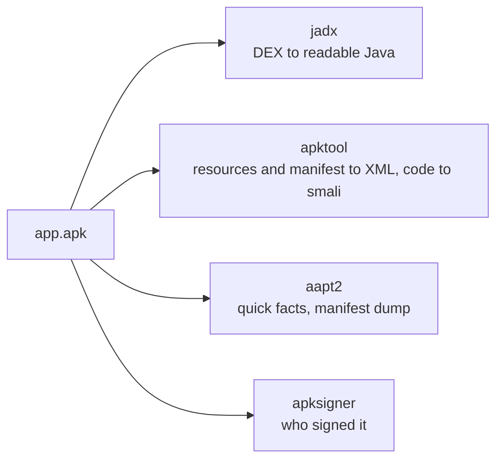

# Inspecting apps

An **APK** (Android package) is a ZIP file with a defined layout. Opening one up is a core Android skill: it's how you check what your build actually contains, debug a manifest merge or a missing resource, see how a dependency works, or find out what a preinstalled app does. The workstation has four tools for it, all pinned and on PATH in `aosp-academy shell`.

!!! note "Inspect what you have the right to"
    Decompiling is a normal engineering activity: your own builds, open-source APKs, the apps on a device you own. Respect licenses and don't redistribute other people's code. The examples below use the open-source Fossify apps on the image and files in this repository.

## What's inside an APK

```text
app.apk  (a ZIP)
├── AndroidManifest.xml     components, permissions, SDK levels (binary-encoded XML)
├── classes.dex             the code, as DEX bytecode (classes2.dex ... for large apps)
├── resources.arsc          compiled resources: strings, dimensions, styles
├── res/                    images, layouts (layouts binary-encoded too)
├── lib/<abi>/*.so          native libraries, one folder per CPU architecture
└── META-INF/               signature files (older schemes; newer ones live in the signing block)
```

Your own build is in your project, at `app/build/outputs/apk/debug/app-debug.apk`. Any installed app can be pulled off the phone; `pm path` gives the file's location:

```sh
adb shell pm path org.fossify.gallery          # package:/product/app/FossifyGallery/FossifyGallery.apk (or similar)
adb pull <that path> work/gallery.apk
```

`work/` is git-ignored, so pulled APKs and decompiled trees never reach the repository.

## Four tools, four jobs



### jadx: read the code as Java

[jadx](https://github.com/skylot/jadx) decompiles DEX bytecode back into readable Java source. It's the best first look at what an app *does*. The pinned command-line version is in `work/tools/jadx`.

```sh
jadx -d work/gallery-src work/gallery.apk      # the whole app as a Java source tree
jadx-gui work/gallery.apk                      # or browse it, with search and cross-references
```

Kotlin code comes out as Java too, readable but more verbose; code shrunk with R8 has short meaningless names unless a mapping file is supplied. Try the round trip on the project's own helper program, which `aosp-academy check` also does:

```sh
jadx -d work/helper-src stock/helpers/UpdateHelper.dex
```

### apktool: resources and the manifest

[apktool](https://apktool.org/) turns the binary `AndroidManifest.xml` and `resources.arsc` back into readable XML, and the code into **smali**, a readable form of DEX assembly. Use it when you care about resources, permissions, components or intent filters, or want to rebuild an APK after a change. It runs through this project's CLI, from the repository root, with the pinned version:

```sh
./aosp-academy apktool d work/gallery.apk -o work/gallery-apktool
# work/gallery-apktool: AndroidManifest.xml (readable), res/, smali/
./aosp-academy apktool b work/gallery-apktool -o work/gallery-rebuilt.apk   # rebuild (unsigned)
```

A rebuilt APK has to be aligned (`zipalign`, in build-tools) and signed with your own key (`apksigner sign`) before it installs, and it then installs only in place of an app signed with that same key.

### aapt2: quick facts without unpacking

`aapt2`, from the pinned build-tools, prints the essentials without a full decode:

```sh
aapt2 dump badging work/gallery.apk             # package, version, SDK levels, permissions, launcher activity
aapt2 dump permissions work/gallery.apk
aapt2 dump xmltree --file AndroidManifest.xml work/gallery.apk   # the manifest as an XML tree
```

Filter the first one with `grep` (or `Select-String` in PowerShell) for `package`, `sdkVersion` or `launchable-activity`.

### apksigner: who signed it

Every APK is signed, and Android only lets an update replace an app signed with the same key. `apksigner`, also from build-tools, checks the signature and prints the certificate:

```sh
apksigner verify --print-certs work/gallery.apk
```

The `Signer #1 certificate SHA-256 digest` line identifies the signer. Your debug builds show Studio's debug key, which differs per PC; that's why a debug build from one PC won't install over one from another without uninstalling first.

## An exercise: check an app in the image

The Fossify apps in the image are pinned in `toolchain.json` with the SHA-256 of their signing certificate (`signerSha256`), taken from F-Droid's signed index, so you can check that the image carries the publisher's signature, unmodified:

1. Pull Fossify Gallery as above.
2. `apksigner verify --print-certs work/gallery.apk`, and compare the SHA-256 digest with the `signerSha256` of `org.fossify.gallery_40.apk` in `toolchain.json`. They match: the build copies the APKs in unmodified, with the publisher's signature intact.
3. `aapt2 dump badging work/gallery.apk` shows its `targetSdkVersion`, which is below the image's API 37, as it is for most apps on any phone: Android runs each app with the behaviour of the API level it targets.
4. Open it in `jadx-gui` and find the activity `aapt2` named as `launchable-activity`.

The same steps on your own release build tell you what you are about to ship.

## Which tool?

| You want | Tool |
| --- | --- |
| Read the logic as Java | **jadx** |
| Read or edit resources, the manifest, or rebuild | **apktool** (`aosp-academy apktool`) |
| One-line package facts, or the manifest as a tree | **aapt2** |
| The signer, or whether the signature is valid | **apksigner** |
| Just list the files or extract one | any ZIP tool (`unzip -l app.apk`, or 7-Zip's `7z l app.apk` on Windows) |
| DEX from your own `.class` files, outside Gradle | **d8** (`aosp-academy d8`), the pinned R8's dexer |
