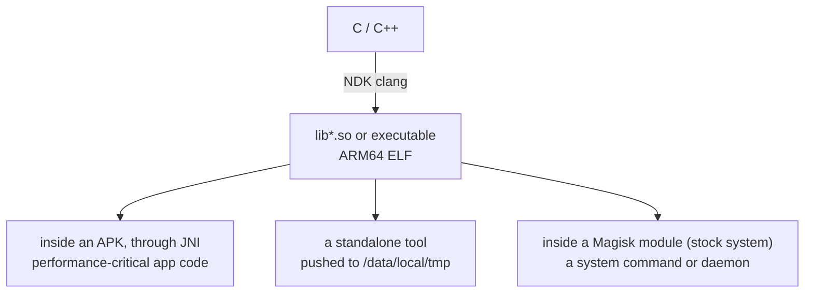

# Native code with the NDK

Not all Android code is Java or Kotlin. The **NDK** (Native Development Kit) compiles C and C++ into native ARM64 machine code that runs directly on the phone's CPU: performance-critical parts of apps (called from Java through **JNI**, the Java Native Interface), libraries ported from other platforms, and command-line tools. `aosp-academy setup` installs the pinned NDK, **30.0.16248370**, into the SDK at `ANDROID_HOME/ndk/30.0.16248370`. In a shell opened with `aosp-academy shell`, `ANDROID_NDK_HOME` points at it.

## What to compile for

```sh
adb shell getprop ro.product.cpu.abi      # arm64-v8a
adb shell getprop ro.build.version.sdk    # 37
```

The phone is **arm64-v8a** (AArch64, 64-bit ARM) and nothing else: no 32-bit ARM, no x86. The image is Android 17, API level 37.

The NDK ships one clang wrapper per architecture and API level, named `aarch64-linux-android<API>-clang` (with `++` for C++). NDK 30.0.16248370 has them for API 21 to 37. The API level in the name is the **oldest** Android version the binary will run on: it chooses which C library functions the binary may use. Anything from 21 to 37 runs on this phone, so pick the level of your app's `minSdk`, not the phone's. The project's own checks use 26.

## Compile a program and run it on the phone

```c title="sysinfo.c"
#include <stdio.h>
#include <sys/utsname.h>
int main(void) {
    struct utsname u;
    uname(&u);
    printf("Native on %s, kernel %s\n", u.machine, u.release);
    return 0;
}
```

=== "bash"

    ```bash
    CC="$ANDROID_NDK_HOME/toolchains/llvm/prebuilt/linux-x86_64/bin/aarch64-linux-android26-clang"   # darwin-x86_64 on macOS
    "$CC" -O2 -o sysinfo sysinfo.c
    ```

=== "PowerShell"

    ```powershell
    $cc = "$env:ANDROID_NDK_HOME\toolchains\llvm\prebuilt\windows-x86_64\bin\aarch64-linux-android26-clang.cmd"
    & $cc -O2 -o sysinfo sysinfo.c
    ```

```sh
adb push sysinfo /data/local/tmp/
adb shell chmod 755 /data/local/tmp/sysinfo
adb shell /data/local/tmp/sysinfo
```

```text
Native on aarch64, kernel 5.15.180-android13-8-...
```

That's cross-compiling: built on an x86-64 PC, run on an ARM64 phone. `/data/local/tmp` is the one place the shell user may write and run programs. The kernel is the phone's own (Motorola's 5.15), the same under the image as on the stock system.

To check what you built, `llvm-readelf` from the same NDK directory reads the binary's ELF header: `llvm-readelf -h sysinfo` should say `Machine: AArch64`. A binary for the wrong architecture won't run at all; `adb shell` reports a format error.

!!! tip "Static linking for portability"
    A program that needs only the C library runs anywhere on the phone. If you hit missing-library errors, `-static` builds a self-contained binary, at the cost of size.

## Native code in an app

In an Android Studio project, native code is built by Gradle with CMake (or ndk-build) and packaged into the APK as `lib/arm64-v8a/lib<name>.so`, which Java or Kotlin loads with `System.loadLibrary("<name>")`. Studio's **New Project, Native C++** template sets that up. Two settings tie the build to this environment, in the module's `build.gradle.kts`:

```kotlin
android {
    ndkVersion = "30.0.16248370"            // the pinned NDK, already in ANDROID_HOME
    defaultConfig {
        ndk { abiFilters += "arm64-v8a" }   // the phone's only ABI
    }
}
```

Without `ndkVersion`, the Android Gradle plugin picks its own default NDK version, and downloads it if it isn't installed. Without the ABI filter, the APK carries libraries for architectures this phone never uses.

Debugging native code is described under [debugging](debugging.md#native-code). simpleperf, the NDK's sampling profiler, doesn't work on this phone's kernel; see [the simpleperf gap](tracing.md#the-simpleperf-gap) for what to use instead.

## Where native code shows up



The last case belongs to the stock system: [Magisk modules](../device/modules.md) can add a compiled tool to `system/bin` there.

## Check it

The device test's `native` area does the compile-and-run above on its own: it builds a small C program with the pinned NDK's API 26 clang, pushes it to `/data/local/tmp`, runs it, expects it to report `aarch64`, and removes it. `./aosp-academy check` does the same compile on the PC and checks the result is a 64-bit AArch64 ELF binary, so if `check` passes, the toolchain is good.
