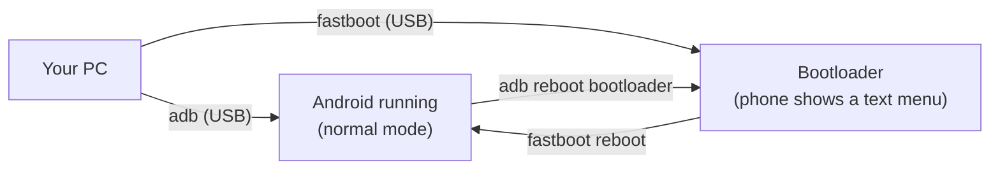

# ADB and Fastboot

You talk to the phone with two different tools, and they work in two different *modes* of the phone. Knowing which mode you are in is half of not making mistakes.



## ADB: when Android is running

**ADB** (Android Debug Bridge) works while Android is booted and USB debugging is on. It gives you a shell, file transfer, app install, log access and screen mirroring. Almost everything in the walkthrough happens over ADB.

| Command | What it does |
| --- | --- |
| `adb devices -l` | List phones. The state column must say `device`. |
| `adb shell <cmd>` | Run one command on the phone. |
| `adb shell` | Interactive shell. `exit` to leave. |
| `adb push <pc-file> <phone-path>` | Copy a file to the phone. |
| `adb pull <phone-path> <pc-file>` | Copy a file from the phone. |
| `adb install <apk>` | Install an app. |
| `adb logcat` | Stream the system log. |
| `adb reboot` | Reboot normally. |
| `adb reboot bootloader` | Reboot into the bootloader so you can use Fastboot. |
| `adb kill-server` | Stop the background server on the PC. |

### The two ends

On the PC, `adb` is a *client* that talks to an `adb` *server* process it starts on first use. On the phone, a daemon called `adbd` runs as the `shell` user. Commands flow PC client → PC server → USB → `adbd`.

Why this matters: **only one server can own the USB connection**. If two different `adb` versions on your PC both try to start servers, they fight, and the symptom is devices going `offline` mid-command. This project pins platform-tools 37.0.3 in `work/platform-tools`, and `aosp-academy shell` puts that `adb` first on PATH. The Android SDK that Android Studio uses is pinned to the same version, so the two servers don't fight. If some other `adb` of a different version is on the PC, stop its server (`adb kill-server` with that copy) before phone work.

### `adb shell su`

Once the phone has root, `su` (switch user) lets a shell command run as root instead of as `shell`:

```sh
adb shell su -c id
```

You will see this pattern in every root step of the walkthrough. `su -c '<command>'` means "run this one command as root". If `su` isn't found, the phone has no root, or the root manager hasn't granted the shell permission yet. That is Magisk's `su`, on the stock system. Inside an aosp-academy image, root comes from AOSP's own userdebug `su`, which takes the user id first instead: `su 0 <command>`.

## Fastboot: when the bootloader is running

**Fastboot** works only in **bootloader mode**: the phone shows a plain text screen instead of Android. Get there with `adb reboot bootloader`, or by holding Volume Down while powering on.

In this mode there is no Android, no apps and no ADB. Fastboot talks directly to the bootloader, and its job is to read bootloader variables and write raw partitions.

| Command | What it does |
| --- | --- |
| `fastboot devices -l` | List phones in bootloader mode. |
| `fastboot getvar <name>` | Read a bootloader variable (`product`, `current-slot`, `securestate`, `serialno`, ...). |
| `fastboot flash <partition> <file.img>` | **Write** a raw image to a partition. This is the dangerous one. |
| `fastboot oem unlock <key>` | Motorola's unlock command. Erases the phone. |
| `fastboot reboot` | Boot Android. |
| `fastboot reboot bootloader` | Restart the bootloader itself. |

!!! danger "`fastboot flash` has no undo"
    It overwrites a partition immediately. There is no confirmation and no recycle bin. The walkthrough flashes exactly **two** partitions in the entire procedure, and only after backing them up and checking the file sizes. Never flash a partition the walkthrough doesn't name, and never flash an image that didn't come from *your own* phone (or from Magisk patching *your own* image).

### Fastboot needs the driver

ADB works on Windows with the generic driver. Fastboot does not: without Motorola's signed driver, Windows shows the phone with a yellow warning (error 28) and `fastboot devices` prints nothing. On Windows, `aosp-academy setup` installs the driver and checks its signature; make sure it is installed before the unlock stage. Linux and macOS need no driver.

### Fastboot vs fastbootd

Modern phones have a second, "userspace" Fastboot called **fastbootd** that runs inside Android's recovery environment. It can flash *dynamic* partitions (the big `system`/`vendor`/`product` ones) that the real bootloader can't. The walkthrough mentions it once, because on the tested phone fastbootd *couldn't* access the partition that needed writing, which is why the Magisk image ends up being written from inside Android with root instead. You won't normally need fastbootd.

## Which tool, when

| You want to | Mode | Tool |
| --- | --- | --- |
| Read properties, install apps, run commands, pull backups | Android | `adb` |
| Run a command as root | Android (rooted) | `adb shell su -c ...` |
| Read the bootloader's lock state | Bootloader | `fastboot getvar securestate` |
| Flash the patched bootloader, unlock | Bootloader | `fastboot flash`, `fastboot oem unlock` |
| Write the Magisk image on this phone | Android (temporarily rooted) | `adb shell su -c dd ...` (not fastboot; see above) |

Next: [Partitions and A/B slots](partitions-and-slots.md).
