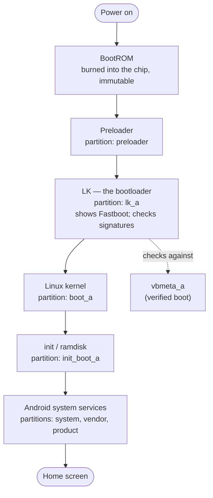
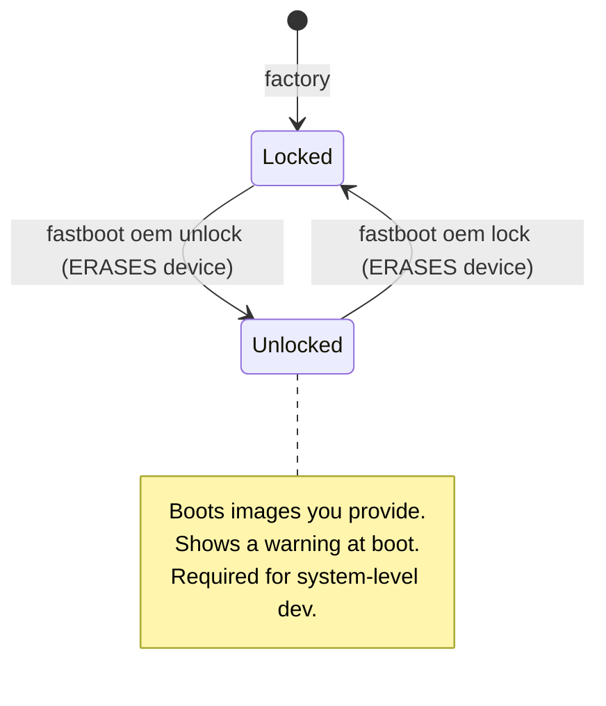

# The boot chain

Between pressing power and seeing the home screen, the device runs a chain of programs, each one starting and checking the next. Understanding this chain is what makes the preparation procedure make sense: every step either reads a link in the chain or replaces one.

## Each link, briefly

| Stage | Lives in | Job |
| --- | --- | --- |
| **BootROM** | The SoC itself | Unchangeable. Loads the preloader. The ultimate root of trust. |
| **Preloader** | `preloader` | Brings up memory, loads LK. |
| **LK** ("Little Kernel") | `lk_a` | MediaTek's bootloader. Draws the Fastboot menu, enforces the lock state, verifies and loads the kernel. **This is the link the procedure patches.** |
| **Kernel** | `boot_a` | The Linux kernel for the device. |
| **init / ramdisk** | `init_boot_a` | The first userspace process, `init`, plus early scripts. **This is where Magisk installs for persistent root.** |
| **Android** | `system`, `vendor`, `product`, … | The OS: frameworks, services, built-in apps. |

## Verified boot and the chain of trust

Each link is cryptographically signed, and the link before it checks that signature before handing over control. The signatures live in the `vbmeta` partitions. This is **Android Verified Boot (AVB)**. Its purpose is integrity: it guarantees the device runs the exact software the vendor shipped, so a corrupted or swapped partition is caught at boot.

## What "locked" and "unlocked" mean

The bootloader has a flag: **locked** or **unlocked**.

- **Locked** (factory default): LK refuses to boot anything whose signature doesn't match the vendor's keys. The device runs only the factory build. This is the right default for a phone you carry.
- **Unlocked**: LK will boot images you provide, even unsigned ones. This is what a **development device** needs: it's how you run your own kernel, a patched `init_boot`, or a custom system image. Google's Pixels expose this directly as an OEM setting; it is a supported, intended capability, not a flaw.

### Unlocking always erases

Switching the flag wipes `userdata`. This is deliberate and it's a *privacy* feature, not an obstacle: it guarantees that nobody can gain system-level access to a device that already has your data on it without first destroying that data. Because you're preparing a fresh development device, the wipe costs you nothing: you set it up, and you'll set it up again after unlocking.

### Why this model is extra work on this device

On a Pixel, unlocking is one OEM toggle plus `fastboot flashing unlock`. This Motorola model doesn't expose that toggle the same way, so the procedure prepares LK itself (via the [Val Protocol](../reference/credits.md) tool) so that the standard `fastboot oem unlock` path works. That LK preparation is the single highest-risk step, because a bad LK can stop the device reaching Fastboot. The [walkthrough](../device/walkthrough.md) treats it with the caution it deserves.

!!! info "Why root is installed in `init_boot`, not flashed as a system change"
    Magisk works by modifying the **ramdisk** in `init_boot` so that `init` starts Magisk's daemon early in boot. Nothing in the read-only `system` image is touched. That's why root here is reversible: restore the original `init_boot` and the device is back to a stock boot, with Magisk gone.

Next: [System-level access](system-access.md).
