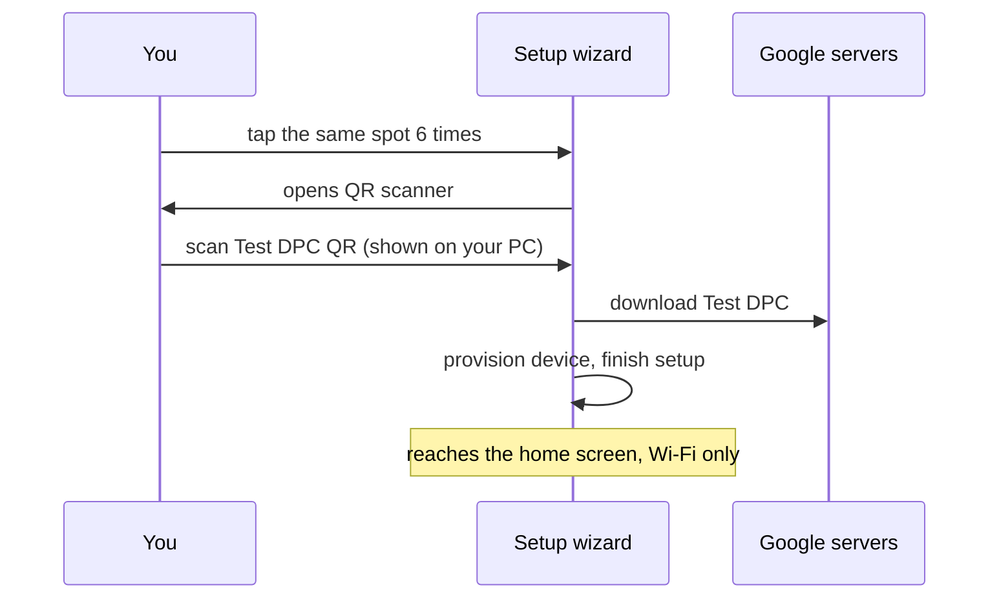

# Device provisioning

Before you can develop on the device, it has to finish Android's first-run setup. On this carrier variant, the out-of-box setup wizard wants to activate a cellular plan. Since this is a **Wi-Fi development device**, the procedure completes setup through Android's standard **enterprise provisioning** path instead. This page explains what that path is and why it's a normal developer tool, not a trick.

## Android has two ways to finish setup

1. **The consumer wizard** — the screens a shopper sees: SIM, Google account, carrier activation.
2. **Enterprise provisioning** — the path a company's IT uses to set up a fleet of devices. A device gets handed to a **Device Policy Controller (DPC)** app that configures it. This is a first-class, documented Android feature ([Android Enterprise](https://developers.google.com/android/work)).

A developer setting up a Wi-Fi-only test device uses path 2 for the same reason IT does: it configures the device without walking through consumer activation.

## Test DPC is Google's own developer tool

The DPC this procedure uses is **[Test DPC](https://github.com/googlesamples/android-testdpc)**, Google's official sample Device Policy Controller. It exists specifically so developers can exercise Android's management APIs. Using it here is using a Google-published developer app for its intended audience.

Provisioning is triggered the documented way: Android's setup wizard scans a **provisioning QR code**, downloads the DPC, and hands the device to it.

The QR image the procedure uses is Google's own, pinned and hash-verified in the toolchain as `testdpc-qrcode.png`.

## Device owner, and why it's removed again

When Test DPC provisions the device it becomes the **device owner** — the most privileged management role, the same one a corporate MDM holds. For a development device you own, you don't want a policy controller sitting in that seat, so the procedure's very next step **removes** it: it clears the device-owner role through Test DPC's own interface and uninstalls the app. You're left with a normally set-up device and no manager.

## The management vocabulary

You'll see these terms in `adb shell dumpsys device_policy`. They're worth knowing as an Android developer:

| Term | Meaning |
| --- | --- |
| **Device Policy Controller (DPC)** | An app that manages a device via the admin APIs. |
| **Device owner** | The top management role; set only during provisioning, before any account is added. |
| **Profile owner** | Manages a work profile, not the whole device. |
| **Device admin** | An older, weaker management hook, predating owners. |
| **Role holder** | An app granted a system **role** (default dialer, financed-device controller, etc.). |

The procedure checks, after removing Test DPC, that *no* device owner, profile owner, or device admin remains — so the device is genuinely yours to develop on, with nothing managing it.

Next: move on to [Prepare the device](../device/index.md), or, if you still want background, revisit any [internals page](index.md).
