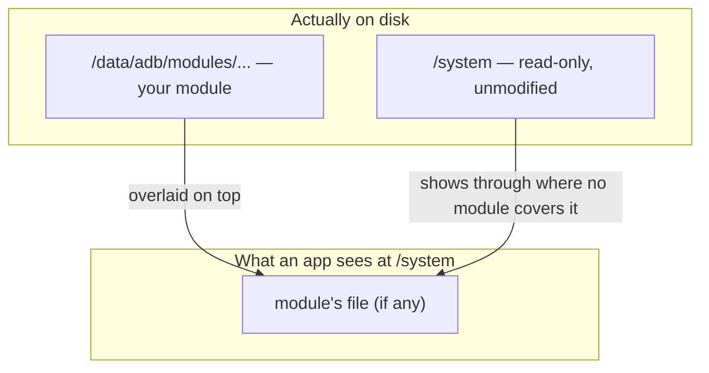

# System modules with Magisk

Once the device has persistent root, **Magisk modules** are how you change system behavior cleanly. They're one of the most useful things to understand on a development device, because they let you test system-level changes without ever editing the system.

## The problem they solve

The `system`, `vendor` and `product` partitions are mounted **read-only** and protected by verified boot. You can't just edit a file in `/system` — the partition won't let you, and even if it did, the change would break the partition's signature.

So how do you change a system file for testing? You *don't change it*. You **overlay** it.

## The systemless overlay

Magisk mounts its modules **on top of** the real system at boot, using Linux bind mounts. The app running later sees the module's version of a file; the real partition underneath is untouched.



Because nothing on the real partition changes, this is called **systemless**. Its consequences are exactly what you want for development:

- **Reversible** — disable the module and reboot; the overlay is gone, the system is pristine.
- **Safe to experiment** — a broken module is removed, not a corrupted partition.
- **Stackable** — many modules can be active at once.

## What's in a module

A module is just a ZIP with a known layout:

```text
mymodule.zip
├── module.prop          id, name, version, description
├── system/              files to overlay onto /system (same paths)
│   └── ...
├── service.sh           (optional) runs late in boot, as root
├── post-fs-data.sh      (optional) runs early in boot
└── customize.sh         (optional) runs once at install
```

Install one with:

```powershell
& $adb push mymodule.zip /data/local/tmp/
& $adb shell su -c 'magisk --install-module /data/local/tmp/mymodule.zip'
& $adb reboot
```

## The five modules in this project

The project ships five modules in `device/modules/`: three that hide directories, for three different reasons, and two that set properties at boot. Each is generated from a manifest in `device/modules/manifests/` by one builder, and you can rebuild all of them with `.\dev\Build-Device.ps1`.

### `wifi-ota-guard` — hide a system app by overlaying nothing

A development device you've carefully prepared shouldn't silently replace its own firmware. This module keeps the Motorola system-update app from running by overlaying its directory with an **empty replacement**, so the app simply isn't there while the module is enabled. Disable the module and reboot, and the updater returns. Nothing was deleted.

### `wifi-carrier-debloat` — the same trick, applied to carrier apps

This Wi-Fi development device doesn't need the preinstalled Verizon/Tracfone carrier and activation apps. This module overlays all 22 of their directories with empty replacements, so they don't run — again, reversibly, without touching the firmware partition. The exact list is in `manifests/wifi-carrier-debloat.json`.

### `wifi-extra-debloat` — the second layer

The carrier module leaves a second layer of preinstalled software untouched: partner stubs (AT&T, Cricket, Facebook), Motorola's telemetry and support apps, Ready For desktop mode, visual voicemail and Digital Wellbeing. `wifi-extra-debloat.zip` hides 19 of those the same way; `manifests/wifi-extra-debloat.json` records each package's on-disk APK path and a one-line description of what it is.

### Script modules

Not every change is a file. Two optional modules in `device/modules/` carry no `system/` tree at all, only a `post-fs-data.sh` that sets a property before the rest of Android starts: `dev_debuggable` sets `ro.debuggable=1` so the device reports itself as an engineering build, and `dev_adb_tcp` makes `adbd` listen on Wi-Fi. The same builder packages them from the same kind of manifest; the manifest names the script instead of listing packages. [Make it an engineering device](../device/dev-setup.md) installs them.

!!! info "`.replace` — the empty-overlay trick"
    The three Wi-Fi modules use Magisk's documented convention: a special `.replace` marker in a module directory tells Magisk to overlay that whole path as empty, hiding whatever the system shipped there. It's the cleanest possible "remove without removing".

!!! note "Modules live in `/data`"
    Magisk keeps installed modules in `/data/adb/modules`. They survive reboots, but a **factory reset** wipes `/data` and takes the modules with it. Reinstall them afterwards.

You'll build your own module in [Build a system module](../develop/magisk-modules.md).

Next: [Device provisioning](device-provisioning.md).
