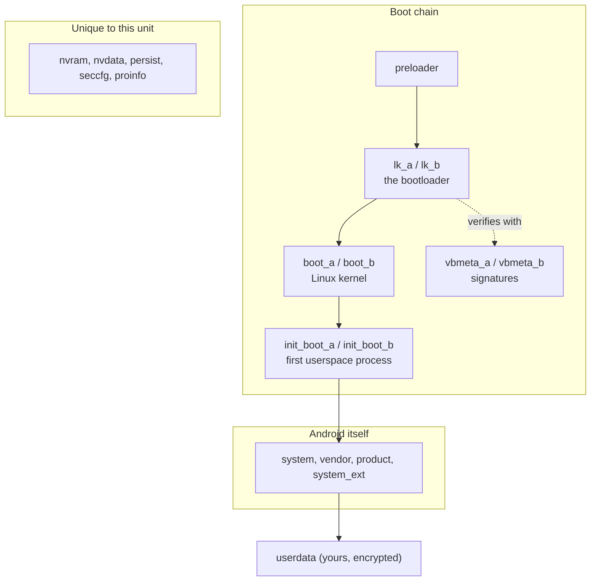

# Partitions and A/B slots

The phone's internal storage is divided into dozens of named **partitions**: fixed regions, each with a job. When the guide says "flash `lk_a`" or "back up `init_boot_a`", it is naming one of them.

On the phone they appear as block devices:

```powershell
& $adb shell ls /dev/block/by-name/
```

## The ones you'll meet



| Partition | What it holds | Role in this guide |
| --- | --- | --- |
| `preloader` | The chip vendor's first-stage code | Backed up only. Never touched. |
| `lk_a`, `lk_b` | **LK** ("Little Kernel"): MediaTek's bootloader. It shows the Fastboot menu, checks signatures, and loads the kernel. | **Patched and flashed** (slot A only). This is what makes unlocking possible. |
| `boot_a`, `boot_b` | The Linux kernel | Backed up only. |
| `init_boot_a`, `init_boot_b` | The *ramdisk* with `init`, the first userspace process | **Patched by Magisk and written** (slot A only). This is where persistent root lives. |
| `vbmeta_*` | Verified-boot signatures for the partitions above | Backed up only. |
| `misc` | Small scratch area the bootloader and update engine use to pass messages (which slot to boot next, etc.) | Backed up; briefly made writable if a staged update must be cancelled. |
| `system`, `vendor`, `product`, `system_ext` | The Android OS | Never written. Magisk modules *overlay* them instead. |
| `nvram`, `nvdata`, `persist`, `seccfg`, `proinfo`, `protect1/2` | Radio calibration, security state, identifiers | Backed up only. **Never share or restore someone else's.** |
| `userdata` | Your apps and files | Erased by the bootloader unlock. |

## Why A and B?

Most partitions in the boot chain come in pairs: `lk_a`/`lk_b`, `boot_a`/`boot_b`, and so on. These are **A/B slots**, Android's seamless-update mechanism.

The phone boots from one slot (the **active** slot). When a system update arrives, it is written to the *other* slot in the background while you keep using the phone. On the next reboot the bootloader switches slots. If the new slot fails to boot, it can fall back to the old one.


Two consequences matter for the guide:

1. **Everything targets slot A, explicitly.** The tested phone was on `_a`, and every command says `lk_a` and `init_boot_a`, never a bare `lk`. If your phone is on slot B, the procedure has not been tested for you. Stop.
2. **A staged update is a trap.** If the phone downloaded an update before you unlocked, slot B now contains *newer* firmware and the bootloader is primed to switch to it on the next reboot. Reboot, and you land on a newer, untested firmware build. The guide has a [whole stage](../device/walkthrough.md#stage-4-if-an-update-is-staged) for detecting and cancelling this. This is also why the guide says to **turn Wi-Fi off the moment you reach the home screen**.

Check your slot any time:

```powershell
& $adb shell getprop ro.boot.slot_suffix      # must print _a
```

## How partitions are read and written

With root, a partition is just a file-like device. The guide backs them up with `dd`, the classic Unix byte-copier:

```sh
dd if=/dev/block/by-name/lk_a of=/data/local/tmp/moto-factory-backup/lk_a.img bs=1048576
```

`if` is the input, `of` the output, `bs` the block size (1 MiB). Reading is harmless. Writing (`if=<file> of=/dev/block/by-name/...`) is how the Magisk image is installed, and it is just as irreversible as `fastboot flash`.

!!! tip "Sizes are a sanity check"
    `lk_a` is 16 MiB and `init_boot_a` is 8 MiB on this phone. The guide checks the sizes of the files it is about to write. A file of the wrong size is a sign something went wrong upstream, and the check stops you before the write.

Next: [The boot chain and bootloader lock](boot-chain.md).
