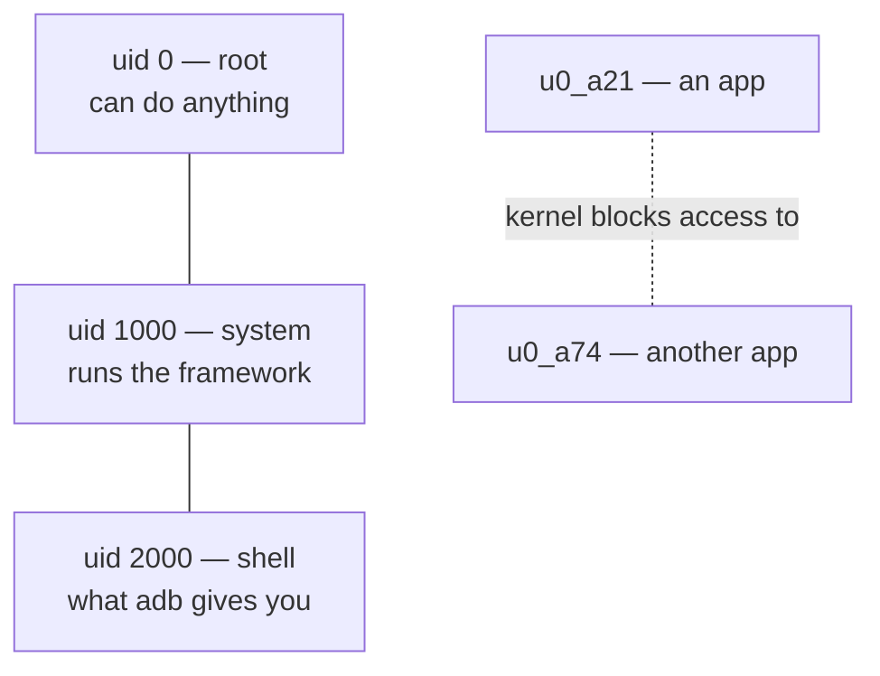
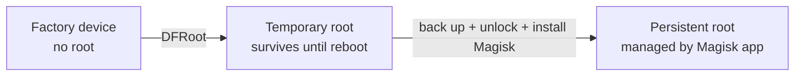

# System-level access

"Root" is the one word everyone knows and few people define. This page defines it, explains why a development device wants it, and shows how the pieces in this project provide it.

## Android is Linux, and Linux has users

Every process on Android runs as a numbered **user id (uid)**. You met two of them in [your first ADB session](../start/first-adb-session.md):

- `uid=2000(shell)` — the account `adb shell` gives you. Deliberately limited.
- Each app gets its **own** uid (like `u0_a123`), and the Linux kernel stops one uid from touching another's files. That per-app isolation *is* the Android app sandbox.

And then there is:

- `uid=0(root)` — the **superuser**. Root is exempt from the permission checks. It can read any file, write any partition, and change any setting.

## Why you can't just become root

On a normal phone there is no `su` ("switch user") binary, and the kernel won't hand out uid 0. That's correct for a device in your pocket: if any app could become root, the sandbox that protects your banking app from a game would be worthless. The lockdown is a *feature* for consumers.

## Why a development device wants it anyway

The moment you develop *for* the platform rather than just writing an app, you need the access the sandbox denies:

- **Read system partitions** to see how the vendor assembled the build, or to back them up.
- **Install system-wide modules** that change framework or system behavior for testing.
- **Run privileged tooling** — profilers, tracers, or a program that calls a system-only API.

This is exactly why the emulator gives you `adb root` on demand, and why Google ships "userdebug" and "eng" builds of AOSP that are rooted by default. A rooted development device is the normal tool of platform work; this project just gives a retail device the same capability.

## The two kinds of root in this project

The procedure uses root in **two stages**, for two different reasons.

### 1. Temporary root (DFRoot + KernelSU)

Early on — *before* the bootloader is unlocked — the procedure needs root just long enough to back up partitions and write the prepared boot image. It gets this with **DFRoot**, which obtains a temporary root shell on the factory kernel, managed through **KernelSU**.

- It is **temporary**: a reboot loses it.
- It relies on a known weakness in this specific factory kernel. That's a normal way to get the first foothold on a device whose bootloader isn't unlocked yet, and it's why the procedure is firmware-specific: a newer kernel may not allow it.

Think of temporary root as a bootstrap: it exists only to help you reach the next stage.

### 2. Persistent root (Magisk)

After the bootloader is unlocked, the procedure installs **Magisk** into `init_boot`. From then on, root starts automatically on every boot and is managed properly through the Magisk app.

- It is **persistent**: it survives reboots.
- It is **managed**: apps request root, and you grant or deny each one in Magisk, the way you'd manage any permission.
- It is **reversible**: restore the original `init_boot` and Magisk is gone.

## Using root responsibly on a dev device

Root turns off the safety rails, so the discipline that matters is *what you grant it to*:

- Grant root only to tools **you** installed for development and trust.
- Deny it to ordinary apps and games. They don't need it, and a dev device is still a device.
- Remember that some apps (banking, some streaming) detect an unlocked or rooted device and refuse to run. That's their choice; this project installs no attempt to hide root from them.

Next: [System modules with Magisk](magisk-modules.md).
