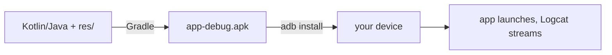

# Your first app in Android Studio

The previous pages ran code the low-level way, to show how Android works underneath. This page uses the normal, polished path most app developers live in: **Android Studio**, the official IDE, which the bootstrap installed. You'll build an app and run it on your prepared device.

!!! warning "Close the dev shell's phone work first"
    Android Studio runs its **own** `adb` server, newer than the kit's pinned 37.0.1. Two servers fighting over one device cause dropped connections. When you switch to Studio, stop the dev shell's server with `& $adb kill-server`, and don't run both against the device at once.

## Create the project

1. Launch **Android Studio**. On first run it finishes downloading SDK bits; it shares the same `ANDROID_HOME` the bootstrap set up, so it won't re-download the platform.
2. **New Project → Empty Views Activity** (or Empty Compose Activity for modern Kotlin UI).
3. Set a package name (e.g. `com.example.firstapp`), language **Kotlin**, and a minimum SDK of **API 26** or higher. Finish.

Gradle, Android's build system, syncs the project. This takes a minute the first time.

## Run it on the device

Your prepared device is an ordinary debuggable Android device as far as Studio is concerned — unlocking it didn't change that, it just added capability.

1. Make sure USB debugging is on and the device is connected.
2. Pick it from the device dropdown in the toolbar.
3. Click **Run** (▶). Studio builds the APK, installs it, and launches it.

That's the whole inner loop of app development: edit, Run, see it on the device. Everything from the earlier pages — DEX, the APK format, the ART runtime — is what Gradle is doing for you automatically now.

## Tools worth opening on day one

- **Logcat** (bottom of the window) — the live system log, filtered to your app. The GUI version of `adb logcat`.
- **Layout Inspector** — see your UI's view hierarchy on the running device.
- **Profilers** — CPU, memory, energy, in real time. This is where a prepared device with system access pays off: you can profile against real hardware, not a simulated emulator.
- **Device Explorer** — browse the device's filesystem from the IDE.

## How this connects to the rest of the project

| The low-level way (earlier pages) | The Android Studio way |
| --- | --- |
| `javac` + `r8d8` by hand | Gradle compiles and dexes for you |
| `app_process` with a bare DEX | ART runs your APK as a sandboxed app |
| `adb install` on the command line | Studio installs on **Run** |
| `adb logcat` in the terminal | the Logcat panel |
| NDK clang by hand | Gradle + CMake build your `.so` |

Neither way is more "real" — they're the same machinery at different altitudes. Knowing the low-level path makes you better at the high-level one, because when Gradle or the runtime does something surprising, you know what's underneath.

## Where to go next

- Build something that talks to the system APIs you reached in [Write a system helper](helper-programs.md) — now from a proper app, where permitted.
- Add a native library with the NDK ([native code](native-code.md)) via Gradle's `externalNativeBuild`.
- Read Google's [Android developer guides](https://developer.android.com/guide) for the app framework itself: activities, services, Jetpack, Compose.

You now have the full span: from a 15-line DEX run as root, up to a Gradle-built app in the IDE, all on a device you prepared yourself.
