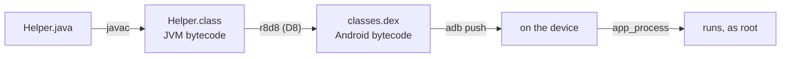

# Write a system helper

This is the shortest path from source code to code running on the device, and it teaches the Android build pipeline better than any app would. The project already contains two real examples: `stock/helpers/UpdateHelper.java` and `stock/helpers/UpdaterCleanup.java`. You'll understand them, then write your own.

## What a "helper" is

Normally Android code ships in an APK and runs inside the ART runtime as a sandboxed app. But Android also has `app_process` — the same launcher the system itself uses to start the runtime — and you can point it at a bare DEX file with no APK at all. Run as root, such a program can call Android's internal system APIs directly.

That's what the project's helpers are: a few lines of Java, compiled to one DEX, launched with `app_process`. No Gradle, no manifest, no APK.

## The pipeline



Two compile steps, because Android doesn't run JVM bytecode. `javac` produces `.class` (JVM); **D8** translates that to **DEX**, the bytecode ART actually runs. The dev shell exposes D8 as `r8d8`.

## Read the project's helper

`stock/helpers/UpdateHelper.java` is a dozen lines of code plus the comment that explains them. It uses **reflection** to call one hidden system API, `android.os.UpdateEngine.resetStatus()` — the supported way to cancel a staged OTA, used in [Stage 4](../device/walkthrough.md#stage-4-if-an-update-is-staged). Reflection is needed because that class isn't in the public SDK, but it's present on the device at runtime. It's a clean example of reaching a system API an ordinary app can't.

Rebuild both helpers from source and confirm they match the committed DEX byte-for-byte:

```powershell
.\stock\Build-StockArtifacts.ps1
```

??? note "How Build-Device compiles them"
    ```powershell
    javac --release 8 UpdateHelper.java
    r8d8 --min-api 26 --output .\out UpdateHelper.class   # → out\classes.dex
    ```
    No Android SDK jar is needed, because the helpers reach the system classes by reflection at runtime rather than compiling against them.

## Write your own

A "hello world" that proves the whole pipeline and reads a system property through the framework:

```java title="DevInfo.java"
public final class DevInfo {
  public static void main(String[] args) throws Exception {
    // SystemProperties is a hidden class; reach it by reflection.
    Class<?> sp = Class.forName("android.os.SystemProperties");
    String model = (String) sp.getMethod("get", String.class)
                              .invoke(null, "ro.product.model");
    System.out.println("Running on: " + model);
    System.out.println("I am uid " + android.os.Process.myUid());
  }
}
```

Compile, push and run:

```powershell
javac --release 8 DevInfo.java
r8d8 --min-api 26 --output . DevInfo.class        # → classes.dex
& $adb push classes.dex /data/local/tmp/devinfo.dex
& $adb shell su -c 'CLASSPATH=/data/local/tmp/devinfo.dex app_process /system/bin DevInfo'
```

```text
Running on: moto g power 2026
I am uid 0
```

`CLASSPATH=<dex>` tells `app_process` where your code is; the final `DevInfo` is the class whose `main` to run. Because you launched it under `su`, `myUid()` is `0` — you're calling the framework as root.

!!! tip "Run as a specific app's uid"
    `UpdaterCleanup.java` is run as the updater app's own uid (`su <uid> -c ...`) so its calls are attributed correctly. Discover a package's uid with `adb shell pm list packages -U <pkg>`. This is a neat way to test a system API *as* a particular app.

## Why this matters for Android development

You just did what platform engineers do: ran code against Android's internal APIs outside the app sandbox. The same technique drives automated device setup, system tests, and tooling. From here, [native code](native-code.md) does the same at the C level, and [Android Studio](android-studio.md) takes you back into the polished app world.
