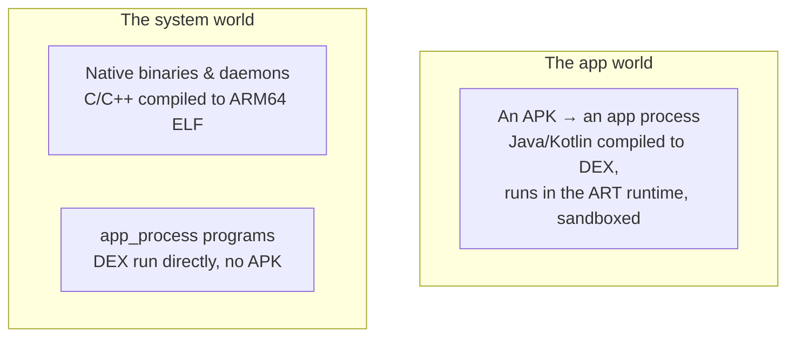

# Develop

Now the device is a development target, here's what you can actually build and learn. Each page is a self-contained project using the tools the [dev environment](../reference/environment.md) already installed. They go from "smallest possible thing that runs on the device" up to a full app.

| Project | You'll learn | Tools |
| --- | --- | --- |
| [Write a system helper](helper-programs.md) | How a `.java` file becomes code running on the device, calling Android's own system APIs | `javac`, `r8d8`, `app_process` |
| [Build a system module](magisk-modules.md) | Changing system behavior reversibly with a [Magisk module](../concepts/magisk-modules.md) | ZIP, `module.prop`, `adb` |
| [Inspect app packages](inspecting-apps.md) | What's inside an APK, and how to read one | `jadx`, `apktool`, `aapt2` |
| [Native code with the NDK](native-code.md) | Compiling C/C++ for the device's ARM64 CPU | NDK, clang |
| [Instrument with Frida](instrumentation.md) | Hooking and tracing any running process, Java or native | `frida`, `frida-trace` |
| [Trace with Perfetto](tracing.md) | Reading what the whole device is doing on one timeline | `perfetto`, `simpleperf` |
| [Build your own system image](aosp-build.md) | Building AOSP's GSI from source in WSL and booting it on the device through DSU | `repo`, `lunch`, `m`, `Install-Gsi.ps1` |
| [Your first app in Android Studio](android-studio.md) | The normal app-development workflow, and the hand-off to it | Android Studio, Gradle |

## The two ways code runs on Android

Everything here is an instance of one of these, so it's worth naming up front:

- **Apps** are the familiar path: Java/Kotlin → **DEX** bytecode → packaged in an **APK** → run by Android's **ART** runtime inside the sandbox. [Inspecting apps](inspecting-apps.md) and [Android Studio](android-studio.md) live here.
- **System code** is the privileged path a development device unlocks: small [`app_process` programs](helper-programs.md) that run DEX directly with no APK, and [native binaries](native-code.md). The project's own helper programs are the clearest possible example.

Start with [Write a system helper](helper-programs.md) — it's the shortest path from source code to "it ran on the device."
