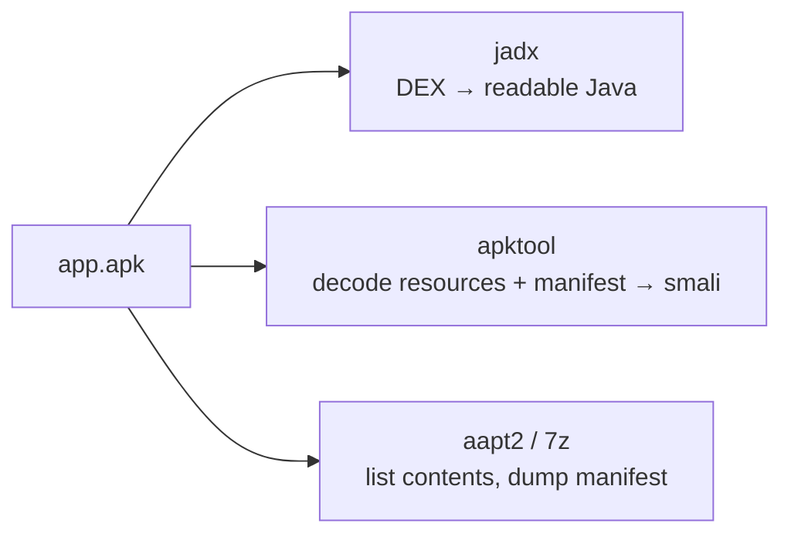

# Inspect app packages

An **APK** is just a ZIP with a defined structure. Learning to open one up is a core Android skill: it's how you understand a dependency, debug a build, check what a preinstalled app does, or learn from an app you admire. The dev environment installed three tools for this.

!!! note "Inspect what you have the right to"
    Decompiling is a normal engineering activity — reading your own builds, open-source APKs, or the system apps on a device you own. Respect licenses and don't redistribute others' code. Everything below uses APKs already on your device or files in this repository.

## What's inside an APK

```text
app.apk  (a ZIP)
├── AndroidManifest.xml     components, permissions (binary-encoded)
├── classes.dex             the code, as DEX bytecode
├── resources.arsc          compiled resources (strings, layouts)
├── res/                    images, layouts
├── lib/<abi>/*.so          native libraries, per CPU
└── META-INF/               signatures
```

Pull one off the device to look at. Every installed app has a path:

```powershell
& $adb shell pm path com.android.vending       # find an app's APK
& $adb pull <the/path/base.apk> "$Work\vending.apk"
```

## Three tools, three jobs



### jadx — read the code as Java

[jadx](https://github.com/skylot/jadx) decompiles DEX back into readable Java. Best first look at what an app *does*.

```powershell
jadx -d "$Work\vending-src" "$Work\vending.apk"     # whole app → Java source tree
jadx-gui "$Work\vending.apk"                         # or browse interactively
```

Try it on the project's own helper to see the round trip — the [self-test](../reference/environment.md) does exactly this:

```powershell
jadx -d "$Work\helper-src" .\stock\helpers\UpdateHelper.dex
```

### apktool — decode resources and the manifest

[apktool](https://apktool.org/) unpacks the binary `AndroidManifest.xml` and `resources.arsc` into readable XML, and the code into **smali** (DEX assembly). Use it when you care about resources, permissions, or want to rebuild.

```powershell
apktool d "$Work\vending.apk" -o "$Work\vending-apktool"
# → AndroidManifest.xml (readable), res/, smali/
```

### aapt2 — quick facts without unpacking

For a fast "what is this APK" without a full decode, `aapt2` (in Build Tools, on your PATH in the dev shell) dumps the essentials:

```powershell
aapt2 dump badging "$Work\vending.apk" | Select-String 'package|launchable|sdkVersion'
```

## A practical exercise

Inspect the carrier apps the device-prep stage disables, to see *why* they're not needed on a Wi-Fi dev device. Their package names and on-disk paths are listed in `stock/modules/manifests/wifi-carrier-debloat.json`. Pull one (before disabling it) and read its manifest with `apktool` to see which carrier services and permissions it declares. This is the same due-diligence you'd do before trusting any preinstalled app.

## jadx vs. apktool — which?

| You want | Tool |
| --- | --- |
| Read the logic as Java | **jadx** |
| Read/edit resources, manifest, or rebuild | **apktool** |
| One-line package facts | **aapt2** |
| Just list files / extract one | **7-Zip** (`7z l app.apk`) |

Next: [Native code with the NDK](native-code.md).
