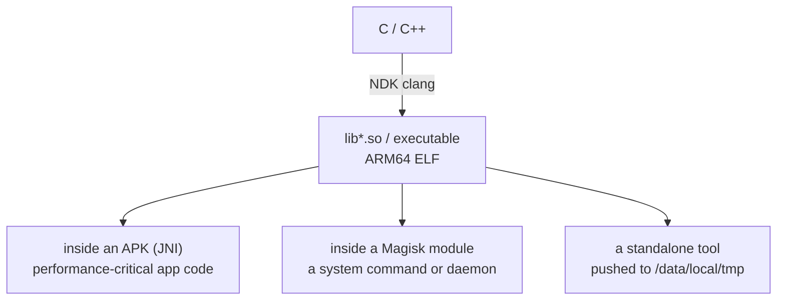

# Native code with the NDK

Not all Android code is Java. The **NDK** (Native Development Kit) compiles C and C++ into native ARM64 binaries that run directly on the device's CPU — the same path used for performance-critical app code, native libraries, and the command-line tools that live in a Magisk module. The bootstrap already installed it.

## The device's CPU

This phone is **arm64-v8a** (AArch64, 64-bit ARM), running Android 16 (API 36). Those two facts pick your compiler.

```powershell
& $adb shell getprop ro.product.cpu.abi      # arm64-v8a
```

The NDK ships a clang pre-configured for each Android API level and architecture. The wrapper you want:

```text
<NDK>\toolchains\llvm\prebuilt\windows-x86_64\bin\aarch64-linux-android36-clang.cmd
```

`$env:ANDROID_NDK_HOME` points at the NDK in the dev shell.

## Compile a binary and run it on the device

```c title="sysinfo.c"
#include <stdio.h>
#include <sys/utsname.h>
int main(void) {
    struct utsname u;
    uname(&u);
    printf("Native on %s, kernel %s\n", u.machine, u.release);
    return 0;
}
```

```powershell
$cc = "$env:ANDROID_NDK_HOME\toolchains\llvm\prebuilt\windows-x86_64\bin\aarch64-linux-android36-clang.cmd"
& $cc -O2 -o sysinfo sysinfo.c
& $adb push sysinfo /data/local/tmp/
& $adb shell chmod 755 /data/local/tmp/sysinfo
& $adb shell /data/local/tmp/sysinfo
```

```text
Native on aarch64, kernel 5.15.180-android13-8-...
```

You just cross-compiled: built on an x86-64 PC, ran on an ARM64 phone. The [self-test](../reference/environment.md) does this same compile and checks the output is a valid AArch64 ELF binary, so if `.\dev\Test-DevEnv.ps1` passed, your toolchain is good.

## Confirm what you built

```powershell
# ELF header: 7F 45 4C 46 (\x7fELF), and e_machine 0xB7 = AArch64
Format-Hex sysinfo -Count 20
```

A binary built for the wrong architecture simply won't run (`adb shell` reports a format error), so this header check is a quick sanity step.

## Where native code shows up



- **In apps** via **JNI** — Java calls into `.so` libraries. Android Studio's NDK support compiles these with CMake.
- **In a [system module](magisk-modules.md)** — ship a compiled tool in `system/bin` for a command the device doesn't have.
- **As a standalone tool** for profiling or testing, as above.

!!! tip "Static-link for portability"
    A tool that depends only on the C library runs anywhere on the device. If you hit missing-library errors, add `-static` for a self-contained binary, at the cost of size.

Next: [Your first app in Android Studio](android-studio.md).
