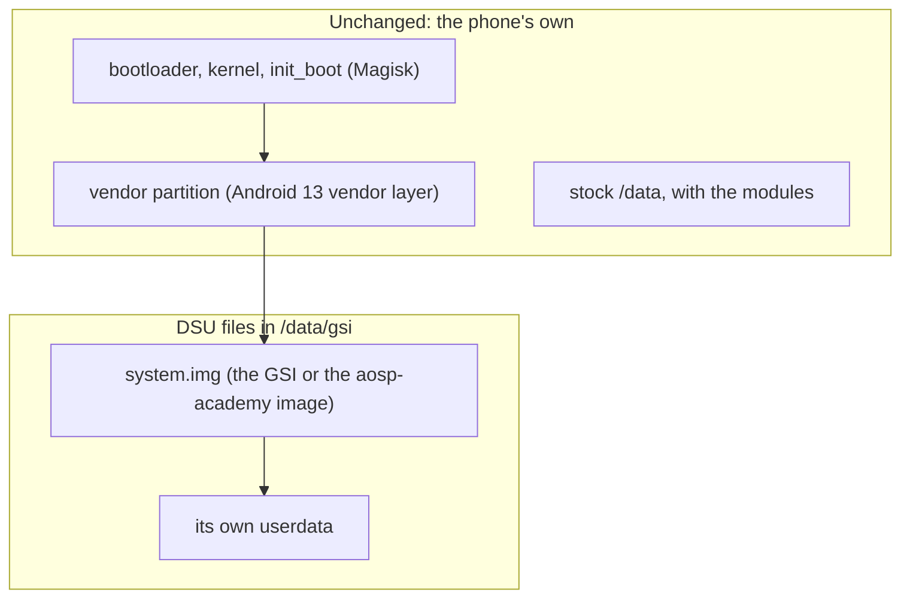

# DSU on this phone

Android is built in two halves: the **system** (the framework, the apps, everything Google and the phone maker put on top) and the **vendor** layer (the hardware support for this exact phone). Since Treble, those halves meet at a defined interface, which is why a **Generic System Image** (GSI), a plain AOSP system built for no phone in particular, can run on a phone with Motorola's vendor partition underneath. This page explains how such a system is booted on this phone without flashing anything, using Google's own GSI as the example. The aosp-academy image is booted exactly the same way; [Deploying an image](../environment/deploying.md) covers the routine for that.

## What DSU is

**Dynamic System Updates** (DSU) is Android's built-in way to boot a second system from image files in `/data`, on top of the phone's own vendor partition and boot images. Nothing is flashed, the A/B slots are untouched, and the second system gets its own separate userdata. It's the right way to run a different system on this phone: it carries the lowest possible risk, and it needs none of the `super`-partition surgery that flashing a GSI can.

What stays the same while a DSU system runs: the bootloader, the kernel and vendor modules, `init_boot` (so Magisk is still in the boot chain), and the stock system's own `/data`. What changes: the whole system partition. With Google's GSI, expect an AOSP launcher, no Motorola apps, no Google apps (it's the plain AOSP image, not the "+GMS" one), and rough edges wherever a generic image has no tuning for MediaTek hardware (camera quality, fingerprint, maybe audio routing). Wi-Fi normally works, because it's a vendor-side service.



All `gsi` commands run from the repository root (`./aosp-academy`, or `.\aosp-academy` on Windows) with the phone on USB, and they need root on the phone: Magisk's `su` on the stock system, AOSP's `su 0` inside an image (the command picks whichever the running system has).

## The pinned GSI

The pinned image is Google's official **AOSP arm64 GSI for Android 17**, build `CP2A.260605.012`, the stable release of the same Android 17 drop as the source tag this project builds its own image from (`deviceTools.gsi` in `toolchain.json` has the build id, URL and SHA-256). It is one generation above the stock Android 16 system and four above the Android 13 vendor layer, and it booted and ran the hardware on this phone on 2026-11-19 (the [validation page](../environment/validation.md)). Until that day the pin was the Android 16 GSI `BP4A.251205.006`; the procedure is the same.

Google publishes the GSI under [its GSI terms](https://developer.android.com/topic/generic-system-image/releases). The download asks you to accept them explicitly, the same way `aosp-academy setup` does for the SDK. It is not fetched by `setup`, because it's about 1 GB and behind those terms.

## Download, install, boot

```sh
aosp-academy gsi download --accept-google-gsi-terms   # ~1 GB into work/device-tools/gsi/, verified against the pinned SHA-256
aosp-academy gsi install                              # pushes the zip; waits for Android's installer (up to 30 min)
aosp-academy gsi boot                                 # enables it and reboots into it: persistent
```

**`download`** without `--accept-google-gsi-terms` prints the terms link and stops. A file that is already there and matches the pin is kept; one that doesn't match is reported, never overwritten.

**`install`** runs from the stock system: it refuses while a DSU image is running (run `gsi stock` first) and while DSU is in any state but `normal` (an image already installed; see `gsi status` and `gsi discard`). It also checks that the phone uses dynamic partitions. It hands the zip to Android's own DSU installer (the same one behind *Developer options → DSU loader* on Pixels), which unpacks `system.img` into `/data/gsi/` and creates an 8 GiB userdata image for the new system (`--userdata-gib N` to change). A phone with a secure lock screen asks for the PIN first. A notification shows progress. `gsi_tool status` reports partitions as installed the moment they're created, while the installer is still writing them, so the command waits for the installer's own status instead (`NOT_STARTED` → `IN_PROGRESS` → `READY`, read from logcat) and fails with that state if it ends anywhere else. `--image <file>` installs your own `system.img` (or a zip with one) instead of the pinned GSI; no pin applies to it.

**`boot`** enables the installed image and reboots into it, then waits for the boot and prints whether the image is running and its build id. By default the image is **persistent**: it stays the phone's system across reboots until you go back to stock. The first boot takes several minutes, because the new system sets itself up.

!!! warning "Use `--single-boot` for an untested image"
    `aosp-academy gsi boot --single-boot` enables the image for **one boot only**: whatever happens, the next reboot, even a forced one by holding **Power**, returns to the stock system. That is the safe way to try an image you haven't booted on this phone before. The persistent default is for images known to boot; `aosp-academy deploy` boots the project's own images persistently too (it has `--single-boot` as well).

## Status

```sh
aosp-academy gsi status
```

prints `gsi_tool status` (for example `normal`, `installed`, `running`), whether an image is running, the build id that is running (`ro.build.display.id`), and whether Google's GSI is downloaded and still matches its pin.

Whether an image is running is read from the **first line of `gsi_tool status`, which says `running`** while a DSU system is up. The property `ro.gsid.image_running`, which Android documents for this, **reads empty on this phone**, so don't rely on it. While Google's GSI runs, `ro.build.fingerprint` is Google's (`google/aosp_arm64/...` or `Android/aosp_arm64/...`), not Motorola's.

## Going back to stock

```sh
aosp-academy gsi stock      # from a running image: disable it and reboot to stock
```

`stock` runs `gsi_tool disable` and reboots. The stock system on slot A, which DSU never touches, comes back with everything as it was. The image **stays installed** in `/data`, and `aosp-academy gsi boot` enables it again. On the stock system, `stock` just says so and does nothing.

After a single boot (`--single-boot`), no command is needed: a plain `adb reboot` returns to stock.

## Discarding the image

```sh
aosp-academy gsi discard    # from the stock system: removes the image and its userdata
```

`discard` runs `gsi_tool disable` and `gsi_tool wipe`, which removes the image and its userdata from `/data` (the GSI takes about 3 GB plus its userdata). It **refuses while an image is running**: run `gsi stock` first. With nothing installed, it says so.

## What happened on this phone

Google's GSI was first tried on unit 2 on 2026-11-16, with the Android 16 GSI that was pinned then (`BP4A.251205.006`), as one-shot boots. The [validation page](../environment/validation.md) has the tables. The short version of that first run:

- **It boots.** The DSU installer accepted the zip (the phone has no `/avb` key set; `system_gsi` still carried Google's AVB key and the install reported `READY`). The boot reached the AOSP home screen well within ten minutes, `ro.build.fingerprint` was `Android/aosp_arm64/generic_arm64:16/BP4A.251205.006/...`, and Developer options showed *DSU Loader: DSU is running*.
- **Working:** the display in its 120 Hz mode, the Mali GPU (OpenGL ES 3.2), Wi-Fi (HAL up, 27 networks in the first scan), audio (the primary output thread exists), 53 sensors registered, the fingerprint HAL registered, USB debugging after enabling it once in the fresh userdata.
- **Partly:** cameras: AOSP sees 2 of the 3 camera devices.
- **Noisy:** `gpuservice` crashes and restarts every 30 seconds (`SIGABRT`), a mismatch between the generic image and the Mali vendor libraries. The UI doesn't depend on it, but it's a steady drip of crash logs and a little CPU.
- **Magisk:** `magiskd` runs and `/debug_ramdisk/magisk -v` answers `31.1:MAGISK:R`, so the boot chain is intact underneath. `su` is denied, because the Magisk app and its grant database live in the stock system's `/data`, which the GSI doesn't see. Expect no Magisk root inside a GSI, and no modules applied. (The aosp-academy image is a userdebug build with AOSP's own `su`, so it has root of its own.)

Things worth checking on any new system, and noting if they fail: Wi-Fi, the display at 120 Hz, audio, the cameras, the fingerprint reader, USB debugging, and whether `aosp-academy device mirror` connects. Google's AOSP image shows a persistent notification offering to **Keep** the DSU across reboots or **Discard** it; you don't need either, since the commands above do both.

**Capture the session before you leave it.** Two things exist only while a DSU system runs: its boot log (which HALs registered, every SELinux denial, the `gpuservice` tombstones) and the vendor interface as the generic system negotiated it. `aosp-academy device info --label gsi --bugreport` records both, plus a full `adb bugreport`, into `work/device-info/` (private). On unit 2 that showed 17 `gpuservice` restarts in ten minutes, denials dominated by the vendor's `batt_health` domain, and the camera service registering only two devices. The drivers themselves are on the vendor partition and identical under stock, so dump those from stock, with root, when you need them.

## If an image doesn't boot

**A single-boot image** that never reaches the home screen: hold **Power** until the phone restarts. Because the boot was one-shot, it comes back to the stock system, and `aosp-academy gsi discard` cleans up.

**Investigating why**, from the stock system: the order is the installer's log (`adb logcat -d`, looking for `dynsystem` lines), then a boot with Magisk's modules disabled (safe mode: hold **Volume Down** during the image's boot), then `gsi_tool install` with a raw image, which bypasses the installer app. None of that touches the stock system. These were the open questions before the first run: whether the DSU installer on this firmware accepts an image it can't verify against Google's key (the phone has no `/avb` key set, and the bootloader is unlocked, which is the condition DSU documents for unverified images), whether Magisk in `init_boot` is happy underneath a foreign system, and the MediaTek vendor interface itself. The first run answered the first two.

**A persistent image that boots** but misbehaves: `aosp-academy gsi stock` works from inside it as long as `adb` reaches the phone and the image has root (the aosp-academy image is a userdebug build with AOSP's `su`).

!!! warning "Not documented yet: a persistent image that doesn't boot"
    If an image enabled **persistently** fails to boot and `adb` can't reach it, there is no tested way back documented here yet. Until there is, boot untested images with `--single-boot`, which always returns to stock on the next reboot. The open item is on the [backlog](../environment/backlog.md).

The stock system underneath is never at risk from DSU, because DSU writes only `/data`. Problems with the boot chain itself are a different matter; see [the stock system](stock.md#if-the-boot-chain-breaks).

## And after that

If a GSI runs well, the next step up would be flashing it to the inactive slot, so it's a real second system rather than a DSU boot; the [hardware inventory](hardware.md) shows `super` has the room. That's a different risk class (slot B's bootloader is stock and untested, and `system` is only flashable from fastbootd) and is not part of this project. A full LineageOS-style port, with a device tree and extracted vendor blobs, is further again: there is no official or community LineageOS build for this model, so a LineageOS *GSI* through the same DSU route is the realistic way to run it here.
