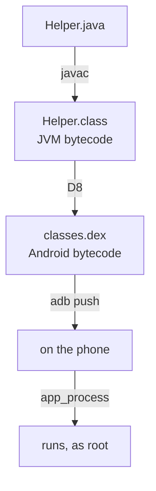

# System helpers

This is the shortest path from source code to code running on the phone, and it teaches the Android build pipeline better than any app would. The project contains two real examples, `stock/helpers/UpdateHelper.java` and `stock/helpers/UpdaterCleanup.java`, which the [preparation walkthrough](walkthrough.md) uses on the stock system. This page explains them, then has you write your own.

## What a "helper" is

Normally Android code ships in an **APK** (an app package) and runs inside **ART**, the Android runtime, as a sandboxed app. But Android also has `app_process`, the same launcher the system itself uses to start the runtime, and you can point it at a bare **DEX** file (Android bytecode) with no APK at all. Run as root, such a program can call Android's internal system APIs directly.

That's what the project's helpers are: a few lines of Java, compiled to one DEX, launched with `app_process`. No Gradle, no manifest, no APK.

## The pipeline



Two compile steps, because Android doesn't run JVM bytecode. `javac` produces `.class` files (JVM bytecode); **D8** translates them to DEX, the bytecode ART actually runs. The project pins D8 as part of R8 and runs it with `aosp-academy d8`.

## The project's helpers

`UpdateHelper.java` is a dozen lines of code plus the comment that explains them. It uses **reflection** to call one hidden system API, `android.os.UpdateEngine.resetStatus()`, the supported way to cancel a staged system update (OTA), which the walkthrough uses if an update was staged before the unlock. Reflection is needed because that class isn't in the public SDK, but it's present on the phone at runtime. It's a clean example of reaching a system API an ordinary app can't.

`UpdaterCleanup.java` removes what the Motorola updater (`com.motorola.ccc.ota`) can leave behind after a cancelled update: its scheduled restart alarm and its "update waiting" notification. Those are the app's own state, separate from the update engine. It reaches the alarm and notification services by reflection, and it has two modes: `inspect` prints the relevant interface signatures and changes nothing, and `cancel` removes the package's alarms and then its notifications. It is a one-off cleanup; the durable block on the updater is the `wifi_ota_guard` [module](modules.md).

Both are derived from parsimo2010's guide (MIT; see the [credits](../reference/credits.md)).

## Build them

`aosp-academy stock build` rebuilds both helpers from source, and the module ZIPs with them, into `work/build/stock/`, and compares each with the committed copy in `stock/`:

```sh
aosp-academy stock build             # prints "identical" or "DIFFERS" per artifact; exit code = number that differ
aosp-academy stock build --promote   # copy the changed artifacts over the committed ones
```

Run it from the repository root (`./aosp-academy`, or `.\aosp-academy` on Windows). The helpers are compiled with `javac --release 8`, then dexed with the pinned D8 at `--min-api 26`. No Android SDK jar is needed, because the helpers reach the system classes by reflection at runtime rather than compiling against them.

The helpers are compared **byte for byte**. A mismatch there usually means a different `javac` build changed the debug line-number tables, not the bytecode that executes. After `--promote`, review `git diff` and commit the source and the artifact together.

## Write your own

A "hello world" that proves the whole pipeline and reads a system property through the framework:

```java title="DevInfo.java"
public final class DevInfo {
  public static void main(String[] args) throws Exception {
    // SystemProperties is a hidden class; reach it by reflection.
    Class<?> sp = Class.forName("android.os.SystemProperties");
    String model = (String) sp.getMethod("get", String.class)
                              .invoke(null, "ro.product.model");
    System.out.println("Running on: " + model);
    System.out.println("I am uid " + android.os.Process.myUid());
  }
}
```

Save it as `work/devinfo/DevInfo.java` (`work/` is git-ignored), then compile, push and run it from the repository root, in a shell opened with `aosp-academy shell` (the pinned JDK and `adb` are on PATH there; on Windows write `.\aosp-academy` for the project's command):

```sh
javac --release 8 -d work/devinfo work/devinfo/DevInfo.java
./aosp-academy d8 --min-api 26 --output work/devinfo work/devinfo/DevInfo.class   # writes work/devinfo/classes.dex
adb push work/devinfo/classes.dex /data/local/tmp/devinfo.dex
adb shell "su -c 'CLASSPATH=/data/local/tmp/devinfo.dex app_process /system/bin DevInfo'"
```

```text
Running on: moto g power 2026
I am uid 0
```

`CLASSPATH=<dex>` tells `app_process` where your code is; the final `DevInfo` is the class whose `main` to run. Because you launched it under `su`, `myUid()` is `0`: you're calling the framework as root.

That is Magisk's `su -c`, on the stock system. Inside an aosp-academy image, AOSP's own `su` takes the uid first instead: `adb shell "su 0 sh -c 'CLASSPATH=/data/local/tmp/devinfo.dex app_process /system/bin DevInfo'"`.

!!! tip "Run as a specific app's uid"
    `UpdaterCleanup` is run as the updater app's own uid (`su <uid> -c ...`), so the system services treat its requests as the package's own. Find a package's uid with `adb shell pm list packages -U <pkg>`; never hard-code one. Android rejects a writable DEX run as an app uid, so make the pushed file read-only first (`chmod 444`). This is a neat way to test a system API *as* a particular app.

## Why this matters

You just did what platform engineers do: ran code against Android's internal APIs outside the app sandbox. The same technique drives automated device setup, system tests and tooling. From here, [native code](../apps/native-code.md) does the same at the C level, and [Android Studio](../apps/android-studio.md) takes you back into the app world.
