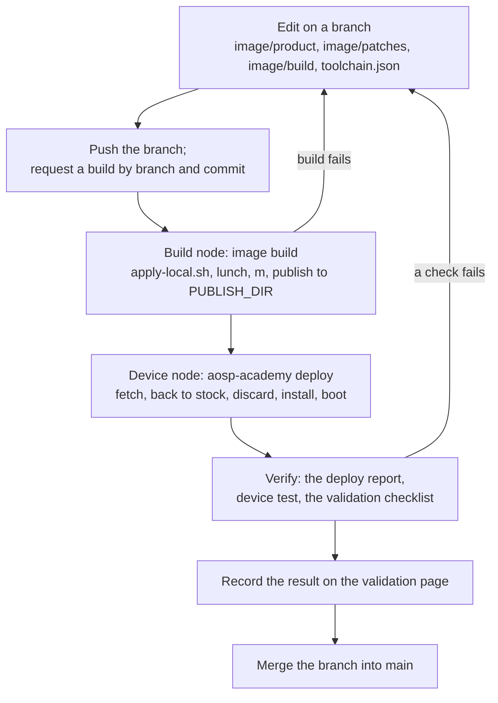

# Change the environment

This section is for whoever maintains the device environment: the system image the phone runs, the scripts that build and deliver it, and the checks that say it still works. If you only build apps against the device, [Develop apps](../apps/index.md) is the section you want; this one explains how what you rely on there is made and changed.

The environment has one moving part that matters day to day: **the image**. It is `aospacademy_arm64`, an Android system image built from the Android Open Source Project (AOSP) source, and booted on top of the phone's own vendor layer through DSU (Dynamic System Updates, Android's way of running a second system from a file without flashing anything; see [DSU](../device/dsu.md)). Everything this project sets on the phone, from the apps to the charge limit, is in that image or in the first-boot service inside it. [What's in the image](image.md) lists it item by item, with the reason for each.

## Two machines, two jobs

The work is split between two machines, called nodes:

| Node | What it is | What it does | What it never does |
| --- | --- | --- | --- |
| **Build node** | Any x86-64 Linux host with about 32 GB of RAM and 400 GB of disk: native Linux, WSL2, a VM or a container. Here it is a Legion T5. | Holds the AOSP source tree, applies this repository's product and patches, builds the image, tests that it built, and publishes it to a folder (`PUBLISH_DIR`). | Touch the phone. |
| **Device node** | The PC the phone is plugged into by USB. Here it runs Windows. | Fetches the published image (`aosp-academy fetch`), installs and boots it on the phone (`aosp-academy deploy`), and verifies it (the deploy report and `aosp-academy device test`). | Build anything with AOSP. It has no AOSP tree. |

The two can be **one machine**: a Linux host, or a Windows PC with WSL2, that can reach the phone, by USB or over the network (adb over Wi-Fi or the WireGuard tunnel). It builds in Linux and deploys from the same checkout, with no publish folder and nothing to fetch; [One machine for both](../start/build-node.md#one-machine-for-both) sets it up. The project ran them apart while every deploy needed a USB cable, because an AOSP build needs a big, fast Linux machine and the phone sat next to a different one. Since 2026-11-20 its build node is both: it builds and deploys over the tunnel, and the device node and the build node's read-only SFTP chroot are retired. When the two are apart, how the device node reaches the publish folder (an SFTP chroot over a VPN, for example) is that host's own setup, not part of the code; [Set up the build node](../start/build-node.md) describes it.

## The change loop

Every change to the environment goes round the same loop. Nothing reaches `main` that hasn't been built, put on the phone and checked.

0. **Try it live first, if it's the first-boot script.** `./aosp-academy device try --rerun` runs the repository's copy of `aospacademy-firstboot.sh` on the image already on the phone, from a fresh first-boot state, in under a minute. A reboot undoes it. Settings and `persist.` properties can be tried by hand the same way (`adb shell settings put ...`, `adb shell su 0 setprop ...`). The build is still what makes a change real; this only shortens the edit-and-retry part.
1. **Edit on a branch.** The image is described entirely by files in this repository: the product in `image/product/aospacademy/gsi/`, the patches to AOSP projects in `image/patches/`, the build scripts in `image/build/`, and the pins (AOSP tag, lunch target, Fossify APKs) in `toolchain.json`. A change made only in the build node's AOSP tree is lost at the next sync; [Build the image](building.md#changing-something-in-the-tree-or-in-the-repository) explains how to try something in the tree and then move it into the repository.
2. **Request a build.** Push the branch and ask for a build of it. A request always names **a branch and a commit** (for example "`restructure` at `452a65f`"), so the image that comes back can be traced to exactly one state of the repository. The build node checks out that commit, and nothing else, before it builds.
3. **The build node builds and tests.** `./aosp-academy image build` downloads and verifies the APK inputs, copies the product and patches into the tree, runs `lunch` and `m`, and publishes the result: `system.img`, the image in 16 parts with their checksums, the image's SHA-256 and its `build.prop`. A build that fails, or a patch that no longer applies, stops here and goes back to the branch. [Build the image](building.md) covers this step.
4. **The device node deploys.** `./aosp-academy deploy` pulls the image, checks it against the build node's SHA-256, takes the phone back to its stock system, discards the old image and its data, installs the new one and boots it. [Deploy and verify](deploying.md) walks through each step.
5. **The device node verifies.** The deploy ends with a report of what the image sets (first boot, HOME role, defaults, charge limit, network, adb keys, crash log) and then runs `device test`, which exercises every development workflow. A change also gets its own check, named in the request. [Validation](validation.md) is the checklist a new image must pass, and the record of every build that passed it.
6. **Merge.** Once the image passes, its validation row is recorded and the branch is merged into `main`. The commit that was built is the commit that is merged.

The phone is a test target, not a store: **every deploy wipes the image's own data** (its userdata partition). The stock system on the phone's own slot, and its data, are never touched by a deploy.

## Rolling back

If a new image is worse than the one before, put the earlier image back. There are two ways, depending on what you still have:

- **Rebuild the earlier commit.** Request a build of the last good commit (the [current image](validation.md#current-image) names its commit; the `baseline-N` git tags mark validated images: `git tag -n1 'baseline-*'`). This is the reproducible path, and the only one once the published image has been replaced: the build script keeps only the newest image in `PUBLISH_DIR`.
- **Re-install a saved image.** If a copy of the earlier `system.img` (with its own `build.prop`) was kept, place both in `work/device-tools/gsi/own/` on the device node and run `./aosp-academy deploy --no-fetch`. [Deploy and verify](deploying.md#rolling-back-to-an-earlier-image) gives the details. Keep a copy of the last validated image before you start a risky change, such as a [tag move](tag-moves.md).

Either way, the rollback is a deploy, so the image's data is wiped. If the phone won't start the image at all, the DSU loader falls back to the stock system after a failed boot, and `./aosp-academy gsi discard` removes the broken image; see [Deploy and verify](deploying.md#going-back-to-stock).

## In this section

- **[What's in the image](image.md)**: every part of `aospacademy_arm64`, and why it's there.
- **[Build the image](building.md)**: the build node's side: apply, lunch, build, publish.
- **[Deploy and verify](deploying.md)**: the device node's side: fetch, deploy, report, test, go back to stock.
- **[Move to a new AOSP release](tag-moves.md)**: how to move the image to a new AOSP tag.
- **[Validation](validation.md)**: the checklist a new image must pass, and the image that passed it.
- **[Backlog](backlog.md)**: what is still open.

The reasons behind the larger choices (no browser, adb authorisation on, no Google endpoints, which system apps stay) are recorded in [Decisions](../reference/decisions.md).
