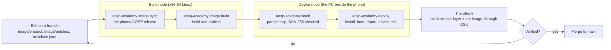

# aosp-academy

**One project that bootstraps and maintains a real phone as an AOSP development device.**

**aosp-academy is an independent, non-commercial, educational project.** It exists to teach how Android works on real hardware. It is not affiliated with Motorola, Lenovo, Google, MediaTek or any carrier, and it redistributes none of their software: everything vendor-made is downloaded by you, from its publisher, under its terms. The full statement is in the [disclaimer](reference/disclaimer.md).

Most Android learning happens on an emulator. Emulators are great, but they hide half of what makes a real device interesting: they boot differently, they already give you a root shell, and they never show you how a shipping phone is put together from partitions, a boot chain and a vendor's system image.

This project works with a **Moto G Power 2026 (XT2617V)** instead. It takes a factory phone and a bare PC to a working development environment, and then keeps that environment in shape:

- **Bootstrap.** Set up the workstation (the pinned SDK, NDK, platform-tools and analysis tools), unlock the bootloader and add root on the stock system, then build this project's own system image from AOSP source and run it on the phone.
- **Maintain.** Change the image, move to a new AOSP release, update a pinned tool, re-verify, recover, or go back to stock.

Apps are not built here. They live in their own projects, which use the device and the workstation this project sets up. The [Develop apps](apps/index.md) section is written for those projects.

If you have never typed `adb`, compiled a line of Java for Android, or wondered what a "bootloader" is, you are in the right place. These docs assume **no prior Android experience**, and the [glossary](reference/glossary.md) defines every term they use.

## Two machines and one loop

The work is split between two computers, called **nodes** here:

- The **build node** is any x86-64 Linux host (a desktop, WSL2 on Windows, a cloud VM or a container). It downloads the AOSP source, builds the image, and publishes it to a folder. A build needs a large disk and a lot of memory, which is why it gets a machine of its own.
- The **device node** is the PC the phone is plugged into, on Windows, Linux or macOS. It never builds the image: it fetches a published one, checks it, installs it on the phone and verifies the result.

The image is an AOSP system image called `aospacademy_arm64`. It runs on top of the phone's own vendor software, and the phone boots it through DSU (Dynamic System Updates), from a file in its data partition, so nothing is flashed and the phone's own system stays intact beside it. Every change to it follows the same loop:



One command line, `aosp-academy`, runs every step on both nodes. It is written in Python with the standard library only, so it runs the same way on Windows, Linux and macOS. The [command reference](reference/cli.md) lists every command and option.

## Where to go

<div class="grid cards" markdown>

-   **Get started**

    ---

    What you need, then the workstation, the build node, the phone, and a first session with `adb`.

    [Get started](start/index.md)

-   **Develop apps**

    ---

    For your app projects: what the image gives you, Android Studio, debugging any process, Perfetto, Frida, the NDK and inspecting APKs.

    [Develop apps](apps/index.md)

-   **Change the environment**

    ---

    What is in the image and why, how it is built and deployed, moving to a new AOSP release, the validation record and the backlog.

    [Change the environment](environment/index.md)

-   **The device**

    ---

    The hardware, how the phone was prepared (unlock and root), the stock system, its helpers and modules, and DSU.

    [The device](device/index.md)

-   **How Android works**

    ---

    ADB and Fastboot, partitions and slots, the boot chain, system access, Magisk modules and provisioning, in plain language with diagrams.

    [How Android works](concepts/index.md)

-   **Reference**

    ---

    Every command, every pin, the decisions and their reasons, troubleshooting, the git workflow, the glossary and the credits.

    [Reference](reference/index.md)

</div>

## Why a development device needs system access

When you launch an Android emulator, you can run `adb root` and get a root shell at once. That access is what lets you read system partitions, install system-wide changes and test privileged code. A retail phone ships locked down: it runs one vendor build and gives you only an unprivileged shell.

To use this phone as a real development target, it is given the same capability, once:

1. **Unlock the bootloader**, the official, vendor-supported switch (`fastboot oem unlock`) that lets a device run builds you provide instead of only the factory one. Every Pixel and most development devices support it directly; on this model it takes an extra preparation step, documented in full.
2. **Install a superuser manager (Magisk)** on the stock system, so you can run privileged code and load system modules, cleanly and reversibly, without changing the read-only system image.

With the bootloader unlocked, the phone can also run this project's own image, a `userdebug` build (the engineering build type Google's own developers use) in which `adb root` works and a debugger can attach to any process.

This is standard platform-development practice on hardware you own. It is not a change you make to someone else's device, and it is not about defeating protections: unlocking deliberately **erases the device**, so that system access always comes with a clean, consenting wipe.

!!! warning "This changes real hardware"
    Unlocking erases the device, and the low-level preparation on this model can, in the worst case, leave it unbootable. The procedure has been carried out on two units of one firmware build; the [validation record](device/index.md#validation-record) records what that does and doesn't establish. Read [How Android works](concepts/index.md) first, then follow the [walkthrough](device/walkthrough.md), which marks every point of no return. Use of this project is subject to the [disclaimer](reference/disclaimer.md).

## How the repository is organized

```text
aosp-academy/
├── aosp-academy, aosp-academy.cmd   the launchers: ./aosp-academy <command>, .\aosp-academy <command>
├── aosp_academy/   the command line (Python, standard library only)
├── toolchain.json  every pin: SDK, tools, device inputs, APKs, the AOSP release and lunch target
├── image/          the system image: product/ (aospacademy_arm64), patches/, build/ (bash + Containerfile)
├── stock/          the stock system's preparation: two helper programs, seven Magisk modules and their builder
├── tests/          unit tests for the command line (no phone, no network)
├── docs/           these pages
└── work/           everything downloaded, generated or private (never committed)
```

The [first session](start/first-session.md) walks through each folder.

## A note on the device's data

Your device's backup images and identifiers are **yours and private**: the images can hold per-unit radio calibration, and the inventory dumps hold serial numbers and IMEIs. All of it goes into `work/`, which git ignores in full, and a [pre-commit hook](reference/git-workflow.md) blocks it from a commit as a second line of defence. The same goes for the private settings of your own network, such as the build node's address or your Wi-Fi details. Keep your backups somewhere safe that isn't a public cloud share: they are how you restore the device.

---

*The device-preparation procedure is derived from the guide created and first tested by [parsimo2010](reference/credits.md) (MIT). This project integrated it, carried it out on a second unit, and built the development environment, the image and these docs around it. See the [credits](reference/credits.md) and the [disclaimer](reference/disclaimer.md).*
