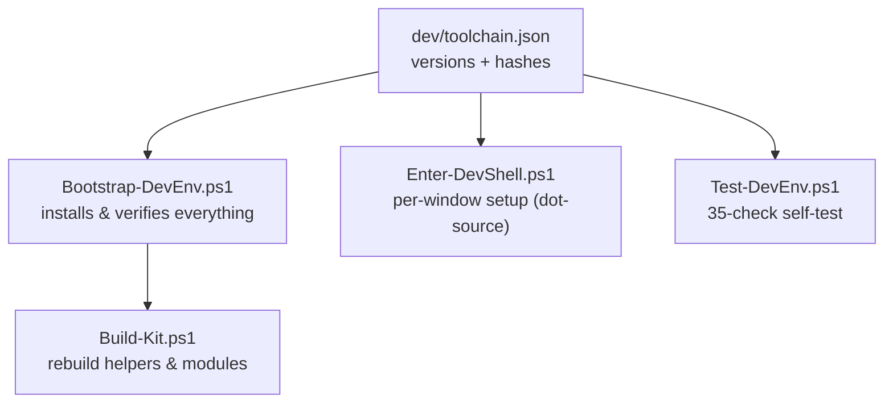

# Dev environment

Everything the bootstrap installs, where it goes, and how the `dev/` scripts fit together. The single source of truth for versions is `dev/toolchain.json`.

## The scripts

| Script | Run it | Does |
| --- | --- | --- |
| `Bootstrap-DevEnv.ps1` | once per machine (re-runnable) | Installs the toolchain, downloads and hash-checks the kit inputs, creates both venvs, enables the git hook. |
| `Enter-DevShell.ps1` | every terminal (`. .\dev\Enter-DevShell.ps1`) | Sets `$Kit $Work $adb $fb $Backup $py`, puts tools on PATH, defines `docs`/`apktool`/`r8d8`, prints status. |
| `Build-Kit.ps1` | when changing helpers/modules | Rebuilds from source and diffs against the committed copies. |
| `Test-DevEnv.ps1` | to verify | Exercises every tool and re-checks every pin. Exit code = failures. |

## What's installed

| Category | Tool | Version | Where |
| --- | --- | --- | --- |
| Java | Microsoft OpenJDK | 21 | `JAVA_HOME` |
| SDK | cmdline-tools, platform-tools, Android 16 platform (API 36), Build Tools 36.1, NDK 30 | pinned | `ANDROID_HOME` = `%LOCALAPPDATA%\Android\Sdk` |
| IDE | Android Studio | latest | Program Files |
| Device | Platform Tools (adb/fastboot) | **37.0.1** | `work\platform-tools` |
| Device | scrcpy | 5.x | winget |
| Inspect | jadx, apktool, 7-Zip | pinned | `dev\.tools`, winget |
| Build | R8/D8 (`r8d8`) | 8.3.37 | `dev\.tools` |
| Python | val-protocol venv | 3.12 | `work\.venv` |
| Python | docs venv (Zensical) | 3.12 | `dev\.venv-docs` |

## Two Platform Tools, on purpose

The device procedure needs the **exact** `adb`/`fastboot` it was tested with (37.0.1), so that copy lives in `work\platform-tools` and the dev shell puts it first on PATH as `$adb`/`$fb`. Android Studio has its own, newer copy for app development. Keep them apart: never run both servers against the device at once.

## Two Python environments, on purpose

- `work\.venv` — the bootloader tooling ([Val Protocol](credits.md)). Kept minimal; `$py` points here.
- `dev\.venv-docs` — builds this site with Zensical. The `docs` command and the CI use it.

Mixing them would risk one's dependencies breaking the other, so they're separate.

## Regenerating the kit artifacts

`Build-Kit.ps1` rebuilds the helper DEX files and module ZIPs and reports whether each matches the committed copy. `-Promote` copies rebuilt files over the originals (then regenerate `kit/SHA256SUMS.txt` and review the diff). The [self-test](#the-scripts) also checks `kit/` against that upstream manifest, so accidental changes are caught.

## Changing a pinned version

1. Edit `dev/toolchain.json` with the new URL and hash from the publisher.
2. Re-run `Bootstrap-DevEnv.ps1`. A file present but not matching its pin is never silently overwritten.
3. Don't touch the `kit` pins unless you're deliberately re-validating the device procedure — those are the exact tested inputs.
