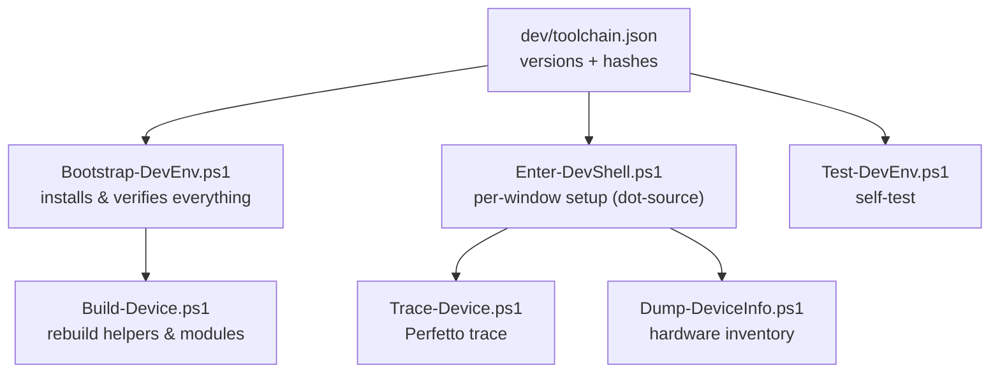

# Dev environment

Everything the bootstrap installs, where it goes, and how the `dev/` scripts fit together. The single source of truth for versions is `dev/toolchain.json`.

## The scripts

| Script | Run it | Does |
| --- | --- | --- |
| `Bootstrap-DevEnv.ps1` | once per machine (re-runnable) | Installs the toolchain, downloads and hash-checks the device inputs and device tools, creates the three venvs, enables the git hook. |
| `Enter-DevShell.ps1` | every terminal (`. .\dev\Enter-DevShell.ps1`) | Moves to the repo root, sets `$Work $adb $fb $Backup $py`, puts tools on PATH, defines `docs`/`apktool`/`r8d8`/`adbwifi`/`Start-Frida`, prints status. |
| `Build-Device.ps1` | when changing helpers/modules | Rebuilds the two helper DEX files and the five module ZIPs in `device/` from source and compares them with the committed copies. |
| `Test-DevEnv.ps1` | to verify | Exercises every tool and re-checks every pin. Exit code = failures. |
| `Trace-Device.ps1` | when profiling | Records a Perfetto trace on the device and pulls it into `work\traces\` ([tracing](../develop/tracing.md)). |
| `Dump-DeviceInfo.ps1` | once per unit or firmware | Writes a hardware inventory into `work\device-info\` (private) and prints an identifier-free summary ([hardware](../device/hardware.md)). |

## What's installed

| Category | Tool | Version | Where |
| --- | --- | --- | --- |
| Java | Microsoft OpenJDK | 21 | `JAVA_HOME` |
| SDK | cmdline-tools, platform-tools, Android 16 platform (API 36), Build Tools 36.1, NDK 30 | pinned | `ANDROID_HOME` = `%LOCALAPPDATA%\Android\Sdk` |
| IDE | Android Studio | latest | Program Files |
| Device | Platform Tools (adb/fastboot) | **37.0.1** | `work\platform-tools` |
| Device | scrcpy | 5.x | winget |
| Inspect | jadx, apktool, 7-Zip | pinned | `dev\.tools`, winget |
| Build | R8/D8 (`r8d8`) | 8.3.37 | `dev\.tools` |
| Python | val-protocol venv | 3.12 | `work\.venv` |
| Python | Frida tools venv (`frida`, `frida-tools`) | 17.26.3 / 14.13.1 | `work\.venv-frida` |
| Python | docs venv (Zensical) | 3.12 | `dev\.venv-docs` |
| Device tools | Frida server (ARM64), Termux APK, F-Droid APK | 17.26.3, 0.118.3, 2.0.3 | `work\device-tools` |

## Two Platform Tools, on purpose

The device procedure needs the **exact** `adb`/`fastboot` it was tested with (37.0.1), so that copy lives in `work\platform-tools` and the dev shell puts it first on PATH as `$adb`/`$fb`. Android Studio has its own, newer copy for app development. Keep them apart: never run both servers against the device at once.

## Three Python environments, on purpose

- `work\.venv` — the bootloader tooling ([Val Protocol](credits.md)). Kept minimal; `$py` points here.
- `work\.venv-frida` — Frida's PC tools, pinned to the same version as the server on the device ([instrumentation](../develop/instrumentation.md)).
- `dev\.venv-docs` — builds this site with Zensical. The `docs` command and the CI use it.

Mixing them would risk one's dependencies breaking the other, so they're separate. The bootstrap recreates any of them that was created at a different path (the repository moved), because a moved venv's launchers fail silently.

## Regenerating the device artifacts

`Build-Device.ps1` rebuilds the helper DEX files and all five module ZIPs from the sources, scripts and manifests in `device/` and reports whether each matches the committed copy. Module builds are deterministic, so they are compared by hash. `-Promote` copies rebuilt files over the originals; review the diff and commit the source and the artifact together. The [self-test](#the-scripts) runs the same comparison, so an edited manifest with a stale ZIP is caught.

## Changing a pinned version

1. Edit `dev/toolchain.json` with the new URL and hash from the publisher.
2. Re-run `Bootstrap-DevEnv.ps1`. A file present but not matching its pin is never silently overwritten.
3. Don't touch the `inputs` pins unless you're deliberately re-validating the device procedure — those are the exact tested inputs, and a re-validation belongs on the [validation page](../device/validation.md).
