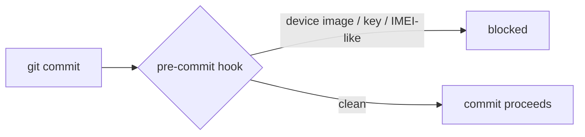

# Git workflow

How this repository is organized for safety, and the commands you'll use day to day.

## The layout, and why

```text
VedoTom/
├── device/  what goes to the device: helpers, modules + manifests + builder, the Magisk prep script
├── dev/     the PC side: bootstrap, dev shell, self-test, artifact rebuild
├── docs/    this site, including the full device procedure
└── work/    everything local and private — git-ignored in full
```

The split exists so the **one rule** is easy to keep: nothing private ever gets committed. All downloads, backups and build outputs go in `work/`, which is ignored wholesale. Everything in `device/` and `dev/` is generic to the model, never to your unit.

## The safety net

Two layers stop device data reaching version control:

1. **`.gitignore`** ignores `work/`, all image/key/log types, and the build outputs.
2. **A pre-commit hook** (`.githooks/pre-commit`, enabled by the bootstrap) blocks a commit if it contains device images, keystores, local secrets, files over 1 MiB, the private working folders, or lines that look like an IMEI or serial.



A fresh clone isn't protected until the hook is enabled, which `Install-Workstation.ps1` does via `git config core.hooksPath .githooks`. If you ever need to bypass a false positive on a file you've checked, `git commit --no-verify`, sparingly.

The [self-test](environment.md) verifies all of this: hook active, private paths ignored, and that the commit email is a GitHub no-reply address. It reports the `origin` repository's visibility but doesn't require it to be private: this is a public project, and the ignore rules plus the hook are what keep device data out of it.

## Where the procedure came from

The device procedure, helpers and first two modules were imported from [parsimo2010's guide](credits.md) and then integrated into this project rather than mirrored. There is no `upstream` remote to track; if the original author publishes a change worth adopting, read it and apply it here deliberately, then update the [validation page](../device/validation.md) if it changes what has been tested. `NOTICE.md` records the imported commit.

## Regenerating the device artifacts

The helper DEX files and module ZIPs in `device/` are build outputs that are committed so the walkthrough can push them straight to the device. After changing a helper source or a module manifest:

```powershell
.\stock\Build-StockArtifacts.ps1            # rebuilds into work\build and reports which committed copies differ
.\stock\Build-StockArtifacts.ps1 -Promote   # copies the rebuilt files over the committed ones
git diff --stat                   # review, then commit the source and the artifact together
```

Module builds are deterministic, so an unchanged manifest always reproduces the committed ZIP byte for byte. The self-test runs the same comparison.

## Daily commands

```powershell
git status
git switch -c my-change       # branch for anything non-trivial
# ... edit ...
git add -p                     # review each hunk
git commit -m "message"        # hook runs automatically
git push -u origin my-change
```

## Publishing the docs

Pushing to `main` triggers `.github/workflows/docs.yml`, which builds the site with `zensical build --strict` and deploys it to GitHub Pages. Pull requests build but don't deploy, so a broken docs change is caught before it publishes. Build locally first with `docs` (live preview) or:

```powershell
work\.venv-docs\Scripts\zensical build --strict --clean
```

## If something private was committed

Stop and don't push. If it's only staged, `git restore --staged <file>`. If it's in your last local commit, `git reset --soft HEAD~1` and recommit without it. If it was already pushed, the history must be rewritten and anything exposed (a key, a serial) treated as compromised, which is exactly what the hook exists to prevent.
