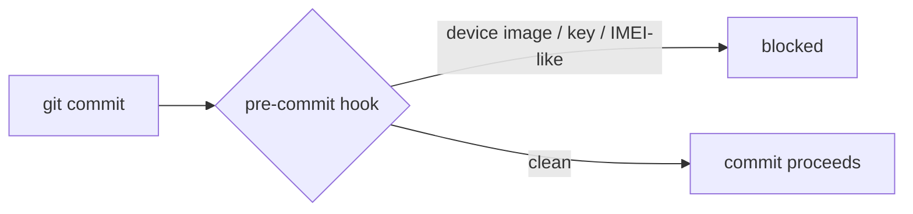

# Git workflow

How this repository is organized for safety, and the commands you'll use day to day.

## The layout, and why

```text
OtomDev/
├── kit/     upstream procedure — read-only reference, verified against its own checksums
├── dev/     the dev environment
├── docs/    this site
└── work/    everything local and private — git-ignored in full
```

The split exists so the **one rule** is easy to keep: nothing private ever gets committed. All downloads, backups and build outputs go in `work/`, which is ignored wholesale.

## The safety net

Two layers stop device data reaching version control:

1. **`.gitignore`** ignores `work/`, all image/key/log types, and the build outputs.
2. **A pre-commit hook** (`.githooks/pre-commit`, enabled by the bootstrap) blocks a commit if it contains device images, keystores, local secrets, files over 1 MiB, the private working folders, or lines that look like an IMEI or serial.



A fresh clone isn't protected until the hook is enabled, which `Bootstrap-DevEnv.ps1` does via `git config core.hooksPath .githooks`. If you ever need to bypass a false positive on a file you've checked, `git commit --no-verify` — sparingly.

The [self-test](environment.md) verifies all of this: hook active, private paths ignored, and (because this is a public repo) that the right things are and aren't tracked.

## Remotes

| Remote | Purpose |
| --- | --- |
| `origin` | your repository (push here) |
| `upstream` | the original guide, fetch-only (push URL deliberately disabled) |

Pull the author's future updates:

```powershell
git fetch upstream
git merge upstream/main      # rename detection maps upstream's root files onto kit/
.\dev\Test-DevEnv.ps1         # flags anything upstream changed in kit/
```

## Daily commands

```powershell
git status
git switch -c my-change       # branch for anything non-trivial
# ... edit ...
git add -p                     # review each hunk
git commit -m "message"        # hook runs automatically
git push -u origin my-change
```

## Publishing the docs

Pushing to `main` triggers `.github/workflows/docs.yml`, which builds the site with `zensical build --strict` and deploys it to GitHub Pages. Pull requests build but don't deploy, so a broken docs change is caught before it publishes. Build locally first with `docs` (live preview) or:

```powershell
dev\.venv-docs\Scripts\zensical build --strict --clean
```

## If something private was committed

Stop and don't push. If it's only staged, `git restore --staged <file>`. If it's in your last local commit, `git reset --soft HEAD~1` and recommit without it. If it was already pushed, the history must be rewritten and anything exposed (a key, a serial) treated as compromised — which is exactly what the hook exists to prevent.
