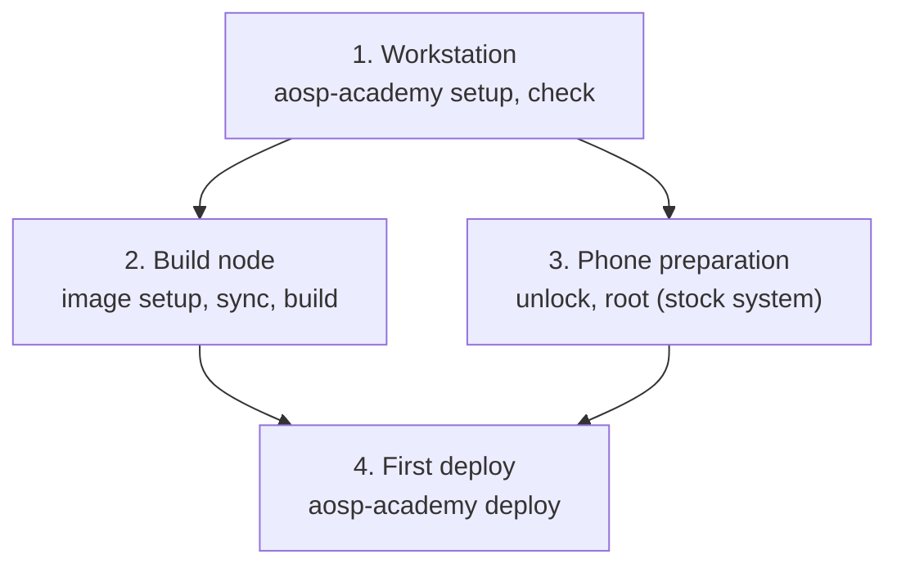

# Get started

This section takes you from "a PC, a phone in a box, and perhaps a Linux machine" to "a working development environment, with this project's image running on the phone and a terminal that talks to it".

## What you need

| Item | Notes |
| --- | --- |
| A workstation | Windows 10 or 11, Linux or macOS, 64-bit, with about 15 GB free for the toolchain. This is the **device node**: the phone is plugged into it. Before anything else it needs **Python 3.11 or newer** and **git**. |
| A build node | Any x86-64 Linux host (native, WSL2, a cloud VM or a container) with 16 cores, 32 GB of RAM and roughly 400 GB of free disk for the AOSP tree and its output. It can be the workstation itself if that runs Linux and is big enough, but it doesn't have to be. |
| The device | Moto G Power 2026, **XT2617V** (the Walmart Straight Talk variant). The low-level preparation is firmware-specific; see [the device](../device/index.md) for the exact tested build. |
| A USB **data** cable | Some cables only charge. The one in the box works. |
| Administrator rights | On Windows, the winget installers and the Motorola USB driver ask for them. |
| No cellular plan | This is a Wi-Fi development device. You don't need a SIM or an activated plan. |

## The order

1. **[Set up the workstation](workstation.md).** One command installs and verifies the whole toolchain, and a second one proves it works. About 20 minutes, mostly downloads.
2. **[Set up the build node](build-node.md).** Prepare a Linux host, download the AOSP source, build the image and publish it. The first sync and build take several hours each, so start them early; you can prepare the phone while they run.
3. **Prepare the phone.** The [preparation walkthrough](../device/walkthrough.md) takes a factory phone to an unlocked bootloader and root on its own (stock) system. It runs once per unit and erases the phone. Read [How Android works](../concepts/index.md) first: the walkthrough assumes you know what a partition and a bootloader are.
4. **Deploy the image.** With a published build and a prepared phone, the device node runs `aosp-academy deploy`, which fetches the image, installs and boots it, and verifies it. [Deploy and verify](../environment/deploying.md) explains each step.

Then [your first session](first-session.md) tours the repository and walks you through talking to the phone with `adb`, using commands that change nothing. You can do it as soon as the workstation is set up, on the stock phone or on the image.

## What "beginner" means here

You should be comfortable opening a terminal, running commands you're given, and reading an error message. Everything else is explained as it comes up. Unfamiliar term? The [glossary](../reference/glossary.md) has it.

You do **not** need to know Java, Kotlin, Linux or anything about Android yet. That's what the rest of the site is for.
